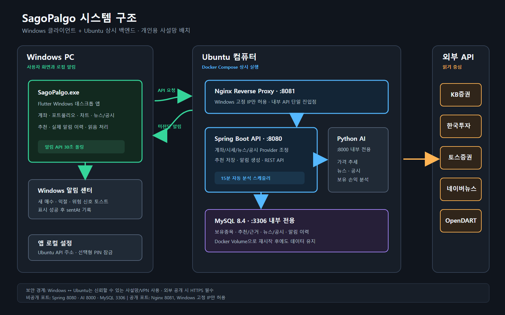

# SagoPalgo

SagoPalgo는 개인이 Windows PC에서 실행해 사용하는 투자 분석 보조 프로그램입니다.
Flutter Windows 앱을 중심으로 KB증권 계좌 데이터, KIS/Toss 시세 데이터, 뉴스/공시, AI 분석, 알림 기능을 한 곳에 모으는 것을 목표로 합니다.

## 프로젝트 방향

- 공개 앱스토어 출시나 상용 SaaS 운영이 아닌 개인용 Windows 프로그램을 우선합니다.
- 실제 계좌 조회, 주문, 체결 등 금융 업무는 KB증권 Open API만 사용합니다.
- KIS와 Toss Open API는 계좌/주문 연동 없이 읽기 전용 시장 데이터 Provider로 사용합니다.
- 같은 현재가를 여러 증권사에서 매번 합치지 않고, 기본 Provider와 fallback Provider를 분리합니다.
- 자동매매는 장기 기능으로만 열어두고, 모의매매와 승인형 주문을 먼저 거칩니다.

자세한 구조와 개발 로드맵은 [개인용 Windows 투자 어시스턴트 설계 문서](docs/personal-windows-investment-assistant.md)를 참고합니다.

## 개인 사용 및 책임 고지

본 프로젝트는 개인 학습 및 개인 투자 분석 보조용 오픈소스입니다.
본 프로젝트는 투자 권유, 투자자문, 수익 보장 서비스를 제공하지 않습니다.
사용자는 각 증권사 Open API 약관과 관련 법령을 직접 확인한 뒤 본인 책임하에 사용해야 합니다.
API Key, 계좌정보, 토큰 등 민감정보를 저장소에 커밋하지 마세요.

## 목표 기능

- KB증권 계좌 조회, 보유 주식 조회, 평가손익 분석
- 국내/해외 주식 현재가, 캔들, 거래량, 시장 지표 조회
- 뉴스와 공시 기반 종목별 AI 분석
- 관심종목, 보유종목, 리스크 신호 알림
- 항상 화면 위에 띄울 수 있는 미니 위젯 모드
- AI 신호 기반 모의매매, 추후 승인형 주문과 제한적 자동매매

## 현재 기술 구조

```text
Front/app_version      Flutter 앱. Windows 데스크톱 실행 파일을 우선 대상으로 전환합니다.
Back/spring-server     Spring Boot API 서버. 초기에는 기존 API와 데이터 구조를 활용합니다.
AI/ai-server           가격·뉴스·공시·보유 손익을 조합하는 로컬 Python 분석 서버입니다.
docs                   설계, API, 수동 테스트, 로드맵 문서를 관리합니다.
docker                 Docker/Nginx 템플릿과 실행 보조 파일을 관리합니다.
```

Flutter 앱은 Windows PC에서 실행하고 Spring Boot, Python AI, MySQL, Nginx는 Ubuntu 컴퓨터의 Docker Compose에서 실행합니다. Ubuntu 백엔드는 앱이 꺼져 있어도 보유 종목을 주기적으로 분석해 알림을 저장하고, Windows 앱은 다시 연결될 때 미전달 알림을 운영체제 알림 센터에 표시합니다.



## 개발 환경 실행

백엔드 개발 환경:

```powershell
docker compose -f docker-compose.yml -f docker-compose.dev.yml --env-file .env.dev up -d --build
```

백엔드 상태 확인:

```powershell
docker compose -f docker-compose.yml -f docker-compose.dev.yml --env-file .env.dev ps
Invoke-WebRequest -Uri http://localhost:8081/health -UseBasicParsing
docker compose -f docker-compose.yml -f docker-compose.dev.yml --env-file .env.dev logs --tail=100 spring-api
```

Flutter Windows 실행:

Windows `.exe` 빌드를 위해 Visual Studio Installer에서 `Desktop development with C++` 워크로드와 `C++ CMake tools for Windows`, `Windows 10 SDK`가 필요합니다.

```powershell
cd Front/app_version
flutter config --enable-windows-desktop
flutter pub get
flutter run -d windows
```

Windows 릴리즈 빌드:

```powershell
cd Front/app_version
flutter build windows --release
```

Ubuntu 백엔드 실행:

```bash
cp .env.prod.example .env.prod
# .env.prod의 Ubuntu 호스트명, DB 비밀번호, Provider 키를 수정합니다.
docker compose -f docker-compose.yml -f docker-compose.prod.yml --env-file .env.prod up -d --build
docker compose -f docker-compose.yml -f docker-compose.prod.yml --env-file .env.prod ps
curl http://localhost:8081/health
```

## 환경 변수

- `.env.dev`: Docker 개발 환경이 읽는 값입니다.
- `.env.prod`: Ubuntu 컴퓨터에서 백엔드 컨테이너를 실행할 때 쓰는 값입니다.
- `.env.dev.example`, `.env.prod.example`: Git에 올리는 예시 파일입니다.
- `Back/spring-server/.env`: Docker 없이 Spring Boot를 직접 실행할 때 쓰는 값입니다.
- `Front/app_version/.env`: Flutter 앱의 공개 설정값입니다.
- 실제 `.env*` 파일은 Git에 올리지 않고, `.env*.example`만 추적합니다.

Windows 앱 잠금 PIN은 Credential Manager에 저장합니다. Ubuntu 백엔드가 사용하는 API Key, access token, 계좌번호는 서버 `.env.prod`로 관리하며 저장소에 커밋하지 않습니다. 인증서와 로컬 DB 백업 역시 저장소 밖에서 별도로 보호합니다.

## 참고 문서

- [개인용 Windows 투자 어시스턴트 설계](docs/personal-windows-investment-assistant.md)
- [API 명세](docs/api-spec.md)
- [데이터베이스 스키마](docs/database-schema.md)
- [Docker 구조](docs/docker-architecture.md)
- [실제 기능 테스트 가이드](docs/manual-test-guide.md)
