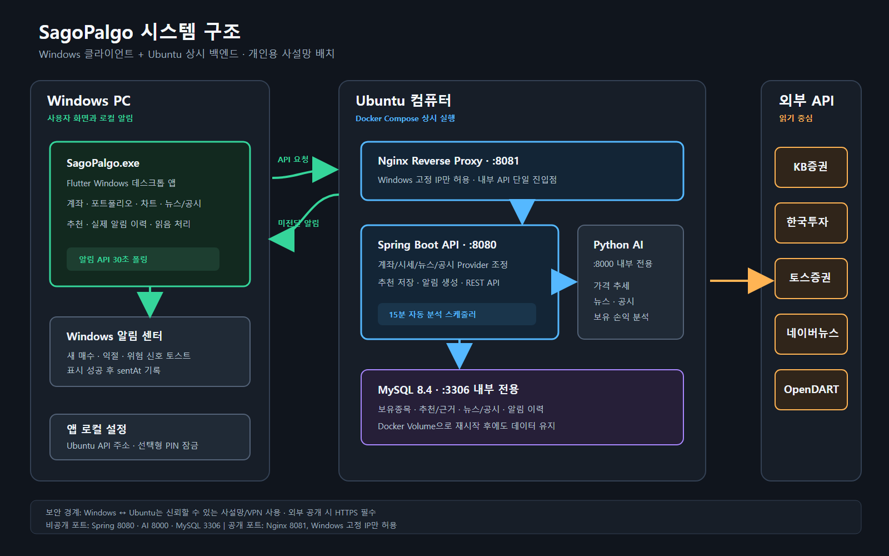

# 사고팔고 Docker 구조

이 문서는 Windows PC에는 Flutter 실행 파일만 두고, Ubuntu 컴퓨터에는 백엔드 컨테이너를 상시 실행하는 개인용 배치 구조를 정리합니다. 공개 인터넷 서비스가 아니라 같은 사설망 또는 VPN 안에서 사용하는 구성이 기준입니다.

이 문서와 아래 이미지는 **현재 배포 구조**입니다. 실시간 수집·과거 데이터 학습·자동 주문을 확장하는 [목표 아키텍처](target-system-architecture.md)와 [최신 개발 로드맵](../project/realtime-trading-roadmap.md)은 별도로 관리합니다. 목표 문서의 신규 논리 모듈이 현재 Compose에 배포된 것으로 해석하지 않습니다.

**목차**

- [1. 관리 범위](#1-관리-범위) · [2. 단일 Compose 구성](#2-단일-compose-구성) · [3. 실행과 기존 설치 전환](#3-실행과-기존-설치-전환)
- [Java 17 보안 패치 적용](#java-17-보안-패치-적용) · [4. 네트워크 기준](#4-네트워크-기준) · [5. 민감정보 기준](#5-민감정보-기준) · [6. 다음 확장](#6-다음-확장)



## 1. 관리 범위

| 영역 | Docker 관리 여부 | 이유 |
| --- | --- | --- |
| Spring Boot API | 관리 | 로컬 실행 환경과 환경 변수를 고정하기 좋음 |
| MySQL | 관리 | PC에 직접 설치하지 않아도 같은 DB 버전을 사용할 수 있음 |
| Nginx reverse proxy | 선택 관리 | Spring API를 프록시 경유로 확인하거나 나중에 로컬 라우팅을 정리할 때 사용 |
| Flutter Windows 프로그램 | Docker 제외 | Windows 알림 센터와 데스크톱 UI를 사용하므로 `.exe`로 직접 실행 |
| Python AI 서버 | 관리 | 가격·뉴스·공시·보유 손익을 독립 프로세스에서 분석 |
| Redis | 추후 관리 | 알림 큐, 캐시, 스케줄링이 필요할 때 추가 |

## 2. 단일 Compose 구성

```text
docker-compose.yml
├─ mysql          데이터는 지정한 기존 Docker 볼륨에 보관
├─ ai-server      Python 통합 분석 서비스
├─ spring-api     Spring API 서비스
└─ reverse-proxy  Windows 앱용 Nginx 프록시
```

`mysql`은 `Back/database/schema.sql`을 빈 데이터 볼륨에서 처음 시작할 때만 실행합니다. 기존 볼륨에서는 init SQL이 다시 실행되지 않으므로 필요한 `Back/database/migrations/` 파일을 백업 후 적용합니다. Compose는 `.env`의 `SAGOPALGO_MYSQL_VOLUME_NAME`이 가리키는 **이미 존재하는** 볼륨만 사용합니다. 이름이 틀리거나 볼륨이 없으면 시작에 실패해 빈 DB로 조용히 전환되지 않습니다. **스키마 갱신을 위해 볼륨을 삭제하지 않습니다.**

`ai-server`는 `/internal/ai/analyze-investment`에서 설명 가능한 가중 점수 분석을 수행합니다. 외부 유료 모델이나 계좌 API를 직접 호출하지 않으며 Spring이 정규화한 입력만 받습니다.

`spring-api`는 Compose가 `--env-file .env`로 받은 값을 컨테이너 환경 변수로 주입합니다. 컨테이너 내부에서는 DB 주소가 `mysql:3306`, AI 서버 주소가 `http://ai-server:8000`입니다.

`reverse-proxy`는 Nginx가 `spring-api:8080`으로 요청을 넘깁니다.

## 3. 실행과 기존 설치 전환

처음 설치할 때는 루트 `.env.example`을 `.env`로 복사해 비밀번호와 Provider 설정을 입력합니다. 같은 PC에서만 접근한다면 기본 프록시 바인딩 `127.0.0.1`을 유지합니다. Windows 앱이 Ubuntu 서버에 접근해야 한다면 `SAGOPALGO_PROXY_BIND_ADDRESS=<Ubuntu의 사설 IP>`, `SAGOPALGO_ALLOWED_CLIENT_IP=<Windows PC의 사설 IP>`로 설정하고 Ubuntu 방화벽에서도 해당 PC만 8081 포트에 접근하도록 제한합니다. `.env`는 저장소에 커밋하지 않습니다.

```bash
cp .env.example .env
# .env의 비밀번호, Provider 키, 프록시 바인딩/허용 IP를 설정합니다.
docker volume create sagopalgo-mysql-data
docker compose --env-file .env config --quiet
docker compose --env-file .env up -d --build
docker compose --env-file .env ps
curl http://localhost:8081/health
```

기존 Ubuntu 설치에서는 **새 볼륨을 만들기 전에** 실제 MySQL 볼륨 이름을 확인하고 DB 백업을 확보합니다. 예전 `-dev` 컨테이너의 볼륨 이름은 아래처럼 읽기 전용으로 확인합니다. `-ubuntu` 컨테이너였다면 이름을 `sagopalgo-mysql-ubuntu`로 바꿉니다. 결과가 비어 있으면 전환을 멈춥니다.

```bash
docker inspect sagopalgo-mysql-dev \
  --format '{{range .Mounts}}{{if eq .Destination "/var/lib/mysql"}}{{.Name}}{{end}}{{end}}'
```

기존 `.env.dev` 또는 `.env.prod`를 **내용을 공개하지 않고** 루트 `.env`로 복사합니다. `.env`가 이미 있으면 덮어쓰지 말고 설정을 확인합니다. `SAGOPALGO_MYSQL_VOLUME_NAME`에는 위에서 확인한 이름을 입력하고, Ubuntu에서 Windows 앱이 접속한다면 프록시 바인딩과 허용 IP도 설정합니다. DB 이름·비밀번호·Provider 키는 기존 값을 유지합니다. 백업·마이그레이션 순서는 아래 절을 따릅니다. 컨테이너 중지 **전에** `docker compose --env-file .env config --quiet`와 `docker volume inspect <확인한-볼륨-이름>`이 모두 성공하는지 확인합니다.

기존 컨테이너와 새 컨테이너는 이름이 다르므로 백업과 `.env` 설정이 끝난 후 기존 컨테이너만 중지해야 포트 충돌을 피할 수 있습니다. 예전 `-dev` 설치라면 다음 명령을 사용합니다. **`down -v`는 실행하지 않습니다.**

```bash
docker stop sagopalgo-reverse-proxy-dev sagopalgo-spring-api-dev sagopalgo-ai-server-dev sagopalgo-mysql-dev
docker compose --env-file .env up -d --build
docker compose --env-file .env ps
```

Ubuntu 방화벽에서는 Windows PC만 프록시 포트에 접근하도록 제한합니다. 외부 인터넷 접속에는 포트포워딩 대신 VPN과 HTTPS를 먼저 구성합니다.

### Java 17 보안 패치 적용

Spring 이미지는 빌드용 JDK와 런타임 JRE에 Java4Shell(`CVE-2026-114938`)을 수정한 Azul Zulu `17.0.21.1+2`를 사용합니다. 각 이미지의 다이제스트를 고정했고 공식 매니페스트는 Linux `amd64`와 `arm64`를 제공합니다. 2026-11-20 공식 Temurin 컨테이너의 동일 수정 버전 태그가 조회되지 않아 Ubuntu 기반의 공식 Azul Zulu 이미지를 선택했습니다. [Azul 보안 공지](https://support.azul.com/hc/en-us/articles/55793255806100-Java4Shell-for-Zulu-and-Zing-CVE-2026-114938) · [Azul 공식 이미지](https://hub.docker.com/r/azul/zulu-openjdk)

가동 중인 서비스와 별도 태그로 먼저 빌드하면 검증 중에도 관찰을 계속할 수 있습니다. 배포 전에 다음 명령으로 새 이미지의 수정 버전을 확인합니다.

```bash
docker build --pull -t sagopalgo-java4shell-verification:17.0.21.1 Back/spring-server
docker run --rm --network none --entrypoint java sagopalgo-java4shell-verification:17.0.21.1 -version
```

2026-11-17~22 U07-D 관찰 수집기는 별도 컨테이너와 DB를 사용하면서 약 1분 간격으로 주 Spring API의 실시간 수집이 `DISABLED`인지 확인합니다. 주 API가 재시작 중이라 응답하지 않으면 관찰 수집기가 중단되고 해당 구간에 공백이 생길 수 있습니다. 11월 22일 15:45 KST 마지막 휴장 체크포인트와 관찰 결과 파일 두 개(`session-observation.json`, `operations-status.json`)가 생성된 뒤 교체합니다. [U07-D 관찰 일정과 보고서](../market-data/kis-session-observation-20261117.md)

교체 시 다음 명령으로 Spring 서비스만 갱신합니다. 실행 JVM에서 `17.0.21.1+2`를 확인하고 Spring의 읽기 전용 API와 기존 수집 상태, 프록시를 사용하는 앱의 접근을 점검합니다. `/health`는 Nginx의 자체 응답입니다. API와 DB 연결 확인에는 별도의 읽기 전용 조회를 사용합니다. [수동 테스트 가이드](../operations/manual-test-guide.md)

```bash
docker compose build --pull spring-api
docker compose up -d --no-deps --no-build --force-recreate spring-api
docker compose exec -T spring-api java -version
```

교체한 Spring의 직접 API는 정상인데 프록시가 `502`를 반환하면 Nginx 로그에서 이전 컨테이너 주소를 사용하고 있는지 확인합니다. 해당 원인이 확인되면 `docker compose exec -T reverse-proxy nginx -t`로 설정을 검증하고 `docker compose exec -T reverse-proxy nginx -s reload`로 반영한 뒤 API를 다시 조회합니다.

### 기존 Ubuntu DB의 KB 점검 이력 테이블

Ubuntu 서버의 저장소 루트에서 `docker ps --format '{{.Names}}'`로 실제 DB 컨테이너 이름을 확인합니다. 새 단일 구성은 `sagopalgo-mysql`입니다. 이전 구성에서 아직 전환하지 않았다면 `sagopalgo-mysql-dev` 또는 `sagopalgo-mysql-ubuntu`일 수 있으며, 아래 명령의 컨테이너 이름만 실제 값으로 바꿉니다. 예시 환경 파일로 기존 비밀값을 덮어쓰지 않습니다.

기존 MySQL 볼륨에 `014_order_read_only_probe_checks.sql`이 적용됐는지 아래 읽기 전용 명령으로 확인합니다. 결과 `1`은 테이블 존재, `0`은 부재를 뜻합니다. 비밀번호·계좌번호·환경 파일 내용은 출력하거나 공유하지 않습니다.

```bash
docker exec -i sagopalgo-mysql \
  sh -lc 'mysql -uroot -p"$MYSQL_ROOT_PASSWORD" "$MYSQL_DATABASE" -N' <<'SQL'
SELECT COUNT(*) FROM information_schema.tables
WHERE table_schema = DATABASE() AND table_name = 'order_read_only_probe_checks';
SQL
```

테이블이 없다면 먼저 현재 DB의 백업을 확보하고, 배포할 코드와 마이그레이션 파일의 버전을 맞춥니다. 아래 예시는 DB 전체를 홈 디렉터리의 접근 제한된 파일로 덤프합니다. 기존 구성에서 전환 중이라면 **기존 컨테이너를 중지하기 전에** 그 이름으로 바꿔 실행합니다. 명령이 성공하고 파일이 비어 있지 않은지 확인한 뒤 백업을 저장소 밖에서 안전하게 보관합니다. 백업 SQL에는 계좌 등 민감 데이터가 포함될 수 있으므로 내용을 출력하거나 공유하지 않습니다.

```bash
umask 077
backup="$HOME/sagopalgo-$(date +%Y%m%d-%H%M%S).sql"
docker exec sagopalgo-mysql \
  sh -lc 'mysqldump -uroot -p"$MYSQL_ROOT_PASSWORD" --single-transaction --routines --triggers "$MYSQL_DATABASE"' \
  > "$backup" && test -s "$backup" && echo 'DB backup created'
```

백업이 확인된 뒤에만 아래 명령으로 `014`를 적용합니다. SQL은 `CREATE TABLE IF NOT EXISTS`이며 기존 데이터를 삭제하지 않습니다. 테이블이 이미 있다면 적용을 건너뛰고 DB 연결과 서버 로그를 조사합니다. **`docker compose down -v` 또는 볼륨 삭제로 스키마를 갱신하지 않습니다.**

```bash
docker exec -i sagopalgo-mysql \
  sh -lc 'mysql -uroot -p"$MYSQL_ROOT_PASSWORD" "$MYSQL_DATABASE"' \
  < Back/database/migrations/014_order_read_only_probe_checks.sql
```

적용 후 첫 번째 읽기 전용 명령을 다시 실행합니다. 이전 백엔드 이미지가 실행 중이라면 `docker compose --env-file .env up -d --build spring-api`로 다시 배포합니다. DB 볼륨을 재생성할 필요는 없습니다.

Windows에서 `scripts/check-kb-probe.ps1 -ApiBaseUrl 'http://<Ubuntu-IP>:8081'`을 실행합니다. `/probe/latest`·`/probe/history`가 계속 500/503이면 오류 코드만 확인하고 `spring-api` 로그를 조사합니다. 테이블 유무만으로 500의 원인을 단정하거나 실제 KB 점검 POST·주문 요청을 보내지 않습니다. `ACCOUNT_NUMBER: false`이면 서버의 계좌번호 설정 여부를 서버 안에서만 확인합니다.

## 4. 네트워크 기준

개인용 사설망 실행에서는 공개 도메인은 필요하지 않습니다. 현재 Compose는 HTTP를 사용하므로 신뢰할 수 있는 LAN이나 VPN 안에서만 접근합니다.

| 용도 | URL | 설명 |
| --- | --- | --- |
| 직접 API 접근 | `http://localhost:8080` | Docker 호스트에서만 접근 |
| AI 상태·계약 확인 | `http://localhost:8000` | Docker 호스트에서만 접근 |
| Ubuntu HTTP 프록시 | `http://ubuntu-server.local:8081` | 바인딩과 허용 IP를 설정했을 때 Windows PC에서 접근 |
| Flutter Windows API | `http://ubuntu-server.local:8081` | `Front/app_version/.env`에 설정 |

MySQL `3306`, Spring `8080`, Python AI `8000`은 Docker 호스트의 `127.0.0.1`에만 바인딩하며 외부에서는 접근할 수 없습니다. Nginx는 `SAGOPALGO_ALLOWED_CLIENT_IP`에 지정한 Windows PC만 API 경로에 접근하도록 제한합니다. 개인용이라도 인증 계층이 없으므로 프록시 공개 범위를 넓히지 않습니다.

같은 PC에서만 앱을 사용한다면 실제 Nginx의 포트 매핑도 `127.0.0.1:8081`인지 `docker compose ps reverse-proxy`로 확인합니다. 사설망 IP나 `0.0.0.0`에 바인딩하면 LAN의 다른 기기에서도 호스트 방화벽이 허용하는 범위로 포트에 접근할 수 있습니다. 인터넷 접근 여부는 라우터 포트포워딩과 터널 등 외부 연결 설정에도 좌우됩니다. Nginx가 보는 요청 출발지는 Docker 환경에서 바뀔 수 있으므로 LAN 모드에서는 별도 허용·비허용 기기로 검증합니다. [Docker 포트 공개 동작](https://docs.docker.com/engine/network/port-publishing/)

## 5. 민감정보 기준

- 루트 `.env`와 `Back/spring-server/.env`는 저장소에 커밋하지 않는다. 이전 `.env.dev`·`.env.prod`도 전환 완료 전까지 보호한다.
- KB/KIS/Toss API Key, App Secret, 계좌번호는 예시 파일에는 빈 값 또는 placeholder만 둔다.
- Windows 앱 잠금 PIN은 Windows Credential Manager에 저장하고 Flutter `.env`에는 남기지 않는다.
- Ubuntu 백엔드가 직접 사용하는 Provider 키와 계좌번호는 서버의 루트 `.env`에 유지한다.
- 현재 백엔드는 로그인/JWT/OAuth를 사용하지 않으므로 Ubuntu 방화벽과 Nginx IP 허용 목록을 반드시 함께 적용한다.
- Spring API는 개인용 로컬 사용자 ID를 기준으로 보유 종목, 관심 종목, 자본금 데이터를 묶는다.

## 6. 다음 확장

1. 여러 Windows 장치 또는 백그라운드 푸시가 필요해지면 Redis/메시지 큐와 장치 인증을 추가한다.
2. 분석 모델을 교체할 때도 Spring의 내부 요청·응답 계약과 저장 구조는 유지한다.
3. 자동 주문 기능을 붙이기 전에는 Docker 설정보다 주문 승인 흐름, 로그, 실패 복구 정책을 먼저 설계한다.
