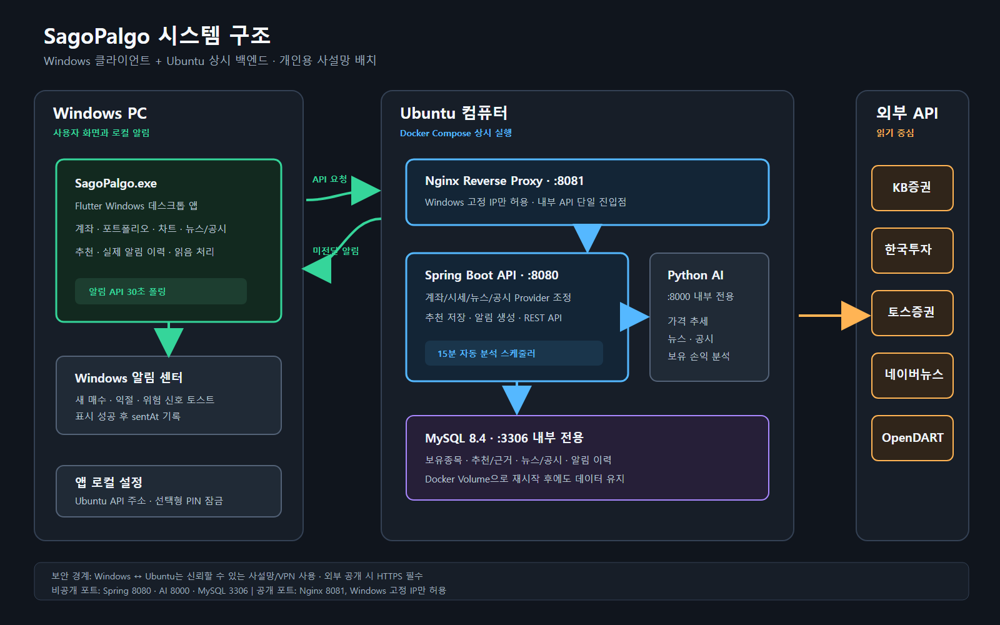

# 사고팔고 Docker 구조

이 문서는 Windows PC에는 Flutter 실행 파일만 두고, Ubuntu 컴퓨터에는 백엔드 컨테이너를 상시 실행하는 개인용 배치 구조를 정리합니다. 공개 인터넷 서비스가 아니라 같은 사설망 또는 VPN 안에서 사용하는 구성이 기준입니다.



## 1. 관리 범위

| 영역 | Docker 관리 여부 | 이유 |
| --- | --- | --- |
| Spring Boot API | 관리 | 로컬 실행 환경과 환경 변수를 고정하기 좋음 |
| MySQL | 관리 | PC에 직접 설치하지 않아도 같은 DB 버전을 사용할 수 있음 |
| Nginx reverse proxy | 선택 관리 | Spring API를 프록시 경유로 확인하거나 나중에 로컬 라우팅을 정리할 때 사용 |
| Flutter Windows 프로그램 | Docker 제외 | Windows 알림 센터와 데스크톱 UI를 사용하므로 `.exe`로 직접 실행 |
| Python AI 서버 | 관리 | 가격·뉴스·공시·보유 손익을 독립 프로세스에서 분석 |
| Redis | 추후 관리 | 알림 큐, 캐시, 스케줄링이 필요할 때 추가 |

## 2. 현재 Compose 서비스

```text
docker-compose.yml
├─ mysql          공통 DB 서비스 정의
├─ ai-server      로컬 Python 통합 분석 서비스
├─ spring-api     공통 API 서비스 정의
└─ reverse-proxy  공통 Nginx 서비스 정의

docker-compose.dev.yml
├─ mysql          개발용 DB 포트 공개
├─ ai-server      개발용 AI API 포트 공개
├─ spring-api     개발용 API 포트 공개
└─ reverse-proxy  개발용 HTTP 프록시 공개

docker-compose.prod.yml
├─ mysql          DB 포트 비공개
├─ ai-server      AI API 포트 비공개
├─ spring-api     API 포트 비공개
└─ reverse-proxy  Ubuntu의 8081 포트만 Windows PC에 공개
```

`mysql`은 `Back/database/schema.sql`을 컨테이너 최초 생성 시 자동 실행합니다. 테이블은 `.env.dev` 또는 `.env.prod`의 `SAGOPALGO_MYSQL_DATABASE` 값으로 만들어진 DB 안에 생성됩니다. 이미 MySQL volume이 만들어진 뒤에는 init SQL이 다시 실행되지 않으므로, 스키마를 다시 만들려면 volume을 삭제하고 다시 생성해야 합니다.

`ai-server`는 `/internal/ai/analyze-investment`에서 설명 가능한 가중 점수 분석을 수행합니다. 외부 유료 모델이나 계좌 API를 직접 호출하지 않으며 Spring이 정규화한 입력만 받습니다.

`spring-api`는 Compose가 `--env-file`로 받은 `.env.dev` 또는 `.env.prod` 값을 컨테이너 환경 변수로 주입합니다. 컨테이너 내부에서는 DB 주소가 `mysql:3306`, AI 서버 주소가 `http://ai-server:8000`입니다.

`reverse-proxy`는 Nginx가 `spring-api:8080`으로 요청을 넘깁니다.

## 3. 실행 명령어

개발 중에는 MySQL, Spring API, Nginx HTTP 포트를 모두 호스트에 공개합니다.

```powershell
docker compose -f docker-compose.yml -f docker-compose.dev.yml --env-file .env.dev up -d --build
docker compose -f docker-compose.yml -f docker-compose.dev.yml --env-file .env.dev ps
Invoke-WebRequest -Uri http://localhost:8081/health -UseBasicParsing
```

Ubuntu 컴퓨터에서는 `.env.prod.example`을 `.env.prod`로 복사하고 DB 비밀번호, Provider 키, Ubuntu 호스트명, Windows PC의 고정 IP를 입력합니다.

```bash
cp .env.prod.example .env.prod
docker compose -f docker-compose.yml -f docker-compose.prod.yml --env-file .env.prod up -d --build
docker compose -f docker-compose.yml -f docker-compose.prod.yml --env-file .env.prod ps
curl http://localhost:8081/health
```

Ubuntu 방화벽에서도 Windows PC만 접근할 수 있게 제한합니다.

```bash
sudo ufw allow from 192.168.0.10 to any port 8081 proto tcp
sudo ufw deny 8081/tcp
sudo ufw enable
```

`192.168.0.10`은 실제 Windows PC의 고정 사설 IP로 바꿉니다. 외부 인터넷에서 접속해야 한다면 포트포워딩 대신 VPN과 HTTPS를 먼저 구성합니다.

## 4. 네트워크 기준

개인용 사설망 실행에서는 공개 도메인은 필요하지 않습니다. 현재 Compose는 HTTP를 사용하므로 신뢰할 수 있는 LAN이나 VPN 안에서만 접근합니다.

| 용도 | URL | 설명 |
| --- | --- | --- |
| 직접 API 접근 | `http://localhost:8080` | 빠른 로컬 개발용 |
| AI 상태·계약 확인 | `http://localhost:8000` | 개발 환경에서만 공개하는 Python 분석 API |
| Ubuntu HTTP 프록시 | `http://ubuntu-server.local:8081` | Windows 앱에 공개하는 유일한 백엔드 포트 |
| Flutter Windows API | `http://ubuntu-server.local:8081` | `Front/app_version/.env`에 설정 |

MySQL `3306`, Spring `8080`, Python AI `8000`은 Docker 내부 네트워크에서만 사용합니다. Nginx는 `SAGOPALGO_ALLOWED_CLIENT_IP`에 지정한 Windows PC만 API 경로에 접근하도록 제한합니다.

## 5. 민감정보 기준

- `.env`, `.env.dev`, `.env.prod`, `Back/spring-server/.env`는 저장소에 커밋하지 않는다.
- KB/KIS/Toss API Key, App Secret, 계좌번호는 예시 파일에는 빈 값 또는 placeholder만 둔다.
- 2단계 기준 민감정보 저장 방식은 `.env`로 확정한다.
- 자동 주문 기능을 붙이기 전에는 Windows Credential Manager 같은 OS 보안 저장소 전환 여부를 다시 검토한다.
- 현재 백엔드는 로그인/JWT/OAuth를 사용하지 않으므로 Ubuntu 방화벽과 Nginx IP 허용 목록을 반드시 함께 적용한다.
- Spring API는 개인용 로컬 사용자 ID를 기준으로 보유 종목, 관심 종목, 자본금 데이터를 묶는다.

## 6. 다음 확장

1. 여러 Windows 장치 또는 백그라운드 푸시가 필요해지면 Redis/메시지 큐와 장치 인증을 추가한다.
2. 분석 모델을 교체할 때도 Spring의 내부 요청·응답 계약과 저장 구조는 유지한다.
3. 자동 주문 기능을 붙이기 전에는 Docker 설정보다 주문 승인 흐름, 로그, 실패 복구 정책을 먼저 설계한다.
