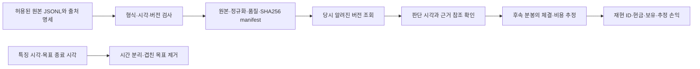

# R5 과거 데이터·시점 재현 기반

2026-11-06 후속: [장중 거래중단·단일가 연결](intraday-session-replay.md)에 명시적 타임라인 적용 경로를 추가했습니다. 구간의 당시 가용 시점·시장/방향·분봉 겹침·미확인 범위를 검사합니다. 적용 보고서는 R5_FOUNDATION_3이며, 아래 무타임라인 R5_FOUNDATION_2 동작과 번들/설정 계약은 보존합니다. 실제 부분 근거를 완전한 일반 세션으로 확정하지 않습니다.

기준일: 2026-11-03. 5번 ‘학습·자동매매·성과 연결’ 중 첫 선행 작업입니다. **오프라인 데이터셋·시점 조회·명시적 주문안 재현 기반**을 구현했습니다. 다년간 실제 데이터 확보, 학습 모델, 시장 전체 후보 탐색, 자동 주문과 기간별 포트폴리오는 이번 완료 범위가 아닙니다. 운영 DB·API·수집/주문 스위치를 변경하지 않습니다.

## 사용 흐름



구현은 [AI 서버의 app/replay](../AI/ai-server/app/replay)에 독립 모듈로 둡니다. FastAPI의 기존 `WEIGHTED_SIGNAL_V1`과 Spring 주문 API는 이 모듈을 호출하지 않습니다. 외부 HTTP·계좌·DB 접속 없이 실행하며 새로운 라이브러리를 추가하지 않았습니다.

## 확보 가능성과 실제 확보 상태

| 자료 | 현재 재사용 가능한 코드/기록 | 이번 단계의 상태·남은 근거 |
|---|---|---|
| 일봉 | KB/KIS 기존 조회·신규 KIS 제한 수집 | 1종목 3년 원주가 730건 수집/대조·개인용 이용 범위 확정. 날짜 정밀도로 보관. 전체 시장/세션·기업행사 정합성은 후속 |
| 분봉 | R2 관측 체결 집계 | MINUTE_1 보관/재현 가능. OBSERVED_ONLY를 완전 분봉으로 올리지 않음. 실제 수집 활성화·과거 분봉 확보·누락 대조 필요 |
| 체결·호가 | R2 원시 공개 이벤트와 제공/수신 시각 | 저장 체결→관측 분봉 변환 기반 추가. 호가 재생/체결 모델은 후속. 추정 날짜를 실제 영업일로 대체하지 않음 |
| 뉴스·공시 | R3 불변 변경 버전·관측 시각 | 전체 버전 내보내기·시각 확인 뉴스 변환 추가. 날짜 공시는 원본 보존/제외. 원문/정정 부모 관계는 후속 |
| 종목군·상장/폐지·정지 | 향후 R4 종목 마스터 | UNIVERSE 이벤트를 명시적으로 입력. 현재 살아 있는 종목만으로 과거 전체 종목군을 대체하지 않음 |
| 기관·외국인·개인 수급 | 공급자 계약 확인 대기 | 이번 형식/전략에 입력하지 않음. 없는 수급을 생성하지 않음 |
| 학습 자료 | 위 형식의 버전 데이터셋과 시간 분리 | 실제 다년간 데이터셋·특징/목표 생성·학습·독립 평가는 후속 |

이번 저장소 예제는 개발자가 만든 `SYNTHETIC_TEST_ONLY` 자료입니다. 가상 코드 `000001`·분봉 5개이며 실제 시세·실제 수익 증거가 아닙니다. 공급자별 과거 조회 가능 기간·해상도·활용권을 API 이름이나 현재 화면의 조회 개수로 확정하지 않습니다.

## 입력 계약

[예제](../AI/ai-server/examples/replay)는 `spec.json`, `records.jsonl`, `config.json`, `split.json` 네 파일입니다. 실행 위치는 `AI/ai-server`입니다.

### 출처 명세와 시각

- `schemaVersion=SAGOPALGO_REPLAY_V1`, 출처 ID·공급자·공개 근거 위치·활용권 상태·자료 생성 경위·한계를 지정합니다. `rights=PERMITTED`는 입력자의 선언이며 프로그램이 라이선스를 검증했다는 뜻이 아닙니다.
- `provenance`는 OBSERVED / PROVIDER_HISTORICAL / SYNTHETIC이며 후속 변환기의 파생 관측은 DERIVED_OBSERVATIONS로 구분합니다. 가상 자료가 섞인 재현은 `allowSynthetic=true`가 필요하며 보고서에도 표시합니다. 선택적 RECEIPT_DERIVED 가용 시각과 별도 opt-in은 [연결 계약](stored-dataset-export.md)을 따릅니다.
- 시간대 있는 ISO 문자열만 받으며 UTC로 정규화합니다. 소수 초는 최대 6자리이고 더 높은 정밀도를 조용히 잘라내지 않습니다. 지원 연구 범위는 2000~2100년, 거래일 경계는 명시적 UTC+09:00입니다. 거래일 달력·정규장 시간표를 구현한 것은 아닙니다. 날짜만 있는 공시 시각을 임의 자정/초로 만들어 입력하지 않습니다.
- 기본 `availability=OBSERVED_AT`에서는 `knownAt=observedAt`입니다. 과거 기사에 적힌 발행일만으로 당시 서버가 이미 받았다고 가정하지 않습니다.
- 역사 자료의 `PUBLICATION_ASSUMED`는 최초 버전에 한해 공개 시각을 가정하며 **별도 근거와 `allowAssumedAvailability=true`가 필요**합니다. 정정 버전과 `LEGACY_BASELINE`은 이 모드에서도 관측 전에는 공개되지 않습니다. 실제 수집 관측을 복원했다는 의미가 아닙니다.

### 공통 행과 자료별 내용

JSONL 행은 `sourceId/kind/itemId/revision/stockCode/exchange/currency/publishedAt/observedAt/payload`를 가집니다. KRX·KRW·6자리 종목 코드로 제한합니다.

| kind | payload |
|---|---|
| BAR | `startAt/endAt/timeframe/open/high/low/close/volume/priceBasis/session/status`. MINUTE_1은 정확히 60초, DAY는 최대 24시간. 가격은 양의 십진 문자열, 수량은 정수 문자열. 현재 RAW·REGULAR만 허용 |
| UNIVERSE | `effectiveAt/eligible/reason`. 알려진 이벤트 중 효력 시각이 된 최신 기록으로 편입/제외 판정 |
| NEWS, DISCLOSURE | `title/summary/link/origin`. 원문 분석 결과나 매매 신호를 추정하지 않음 |

- `publishedAt <= observedAt`, 분봉 종료 이후 공개, OHLC 관계, 음수/NaN/지수형·JSON 실수형 입력을 검사합니다. 숫자 문자열을 float로 바꾸거나 누락을 0으로 채우지 않습니다.
- 같은 자료의 revision은 1부터 연속이어야 합니다. 동일 버전·동일 내용은 중복 제거하고 다른 내용은 충돌로 거절합니다. 종목/봉 구간 변경과 같은 가격 시리즈의 중첩 봉·중복 구간도 거절합니다.
- 버전의 knownAt/관측 시각은 역행할 수 없습니다. 같은 시각의 버전은 revision으로 순서를 정합니다. A→B→A도 별도 버전이며, 특정 시점에는 그때 알려진 최신 버전만 보입니다.
- 공급자별 수정주가 기준이나 기업행사를 확정하지 못했으므로 수정주가를 RAW로 표시해 넣지 않습니다. 원본 형식은 별도 보존한 뒤 근거 있는 변환기를 통해 입력합니다. R2/R3 저장 자료의 명시적 GET 내보내기/파일 변환을 추가했으며 운영 DB 자동 정기 내보내기는 추가하지 않았습니다.

## 데이터셋과 품질 보고서

번들은 원본 `spec.json/raw.jsonl`, 정규화 `records.jsonl`, `quality.json`, `manifest.json`입니다. 원본 바이트를 그대로 보존하고 파일별 SHA-256/크기·형식/엔진 버전으로 datasetId를 만듭니다. 경로와 실행 시각은 ID에 섞지 않습니다. 줄바꿈을 포함한 원본이 달라지면 데이터셋 ID도 달라질 수 있습니다.

생성은 완성된 임시 디렉터리를 게시하며 기존 출력 경로를 덮어쓰지 않습니다. 매번 로드할 때 manifest·파일 해시를 확인하고 원본으로 정규화/품질 결과를 다시 계산합니다. 파일을 수동 수정해도 계속 읽히는 저장소는 아닙니다. 해시는 인증 서명·외부 출처의 진실성 검증을 뜻하지 않습니다.

`expectedBars`는 별도로 확보한 달력/종목 범위에 따른 기대 구간 목록입니다. 해당 목록과 실제 봉의 차이만 보고하며 빈 가격을 생성하지 않습니다. 기대 목록이 없으면 `UNVERIFIED_NO_CALENDAR`입니다. 누락 상세는 최대 100개, 전체 누락 수는 별도로 남깁니다. 권한 미확인·합성 자료·공개 시각 가정·기업행사/종목군 완전성 미확인을 함께 표시합니다.

입력과 산출 파일은 각각 최대 128MiB, 원본 최대 20만 행입니다. 다년간 전 종목 분봉을 한 파일에 넣는 엔진이 아니며 날짜·출처별 분할 저장/범위 통합과 성능 측정은 후속입니다.

## 명시적 주문안 재현

`config.json`에는 기간·자본금·가격/종목군 출처, 비용·지연·신호/평가 만료 기준과 `intents`를 모두 지정합니다. 자동 생성되는 AI 신호가 아닙니다.

1. 모든 주문안의 `decisionAt`에 보이는 동일 종목의 근거 `source/kind/item/revision` 참조를 확인합니다. 가격 출처의 BAR 근거와 그때 알려진 편입 기록이 필요합니다. 이는 근거 참조 시점 검사이며 임의 외부 전략이 실제로 그 근거만 사용했음을 증명하지는 않습니다.
2. 판단 시각보다 **엄격히 뒤**이고 latency를 지난 첫 MINUTE_1 봉을 선택합니다. 만료 시각 미만·같은 UTC+09 거래일·재현 종료 전의 봉만 사용하고 그 봉의 첫 기록도 재현 종료까지 알려져야 합니다. 판단 봉의 종가로 즉시 체결하지 않습니다.
3. 체결 시점의 편입/제외·HALTED·신호 시각·거래량 한도를 확인합니다. 선택적으로 [장중 타임라인](intraday-session-replay.md)을 연결하면 주문 판단과 체결 봉 시작 시각에 알려진 중단/단일가·프로그램 정지 및 미확인 구간을 추가 검사합니다. 타임라인 없는 실행은 장중 제한 검증으로 표시하지 않습니다. 명시한 기대 분봉이 먼저 누락됐거나 첫 체결 봉이 재현 종료 뒤에야 관측됐다면 뒤의 봉으로 대체하지 않습니다. 전체 봉 거래량×참여율은 사후 추정 상한이며 틱별 실제 유동성·체결 가능량을 의미하지 않습니다. 같은 봉에 여러 주문이 있으면 한도를 공유합니다.
4. 시가에 사용자 지정 반스프레드+슬리피지를 불리하게 적용하고 고정 tickSize로 매수 올림/매도 내림합니다. 수수료·매도세를 원 단위 올림해 현금·보유 수량·주문 총액 한도 안에서만 정수 수량을 채웁니다. 공매도·소수점·KB 예약금은 지원하지 않습니다.
5. 부분 체결의 잔여 수량은 취소한 것으로 추정하며 다음 봉으로 이월하지 않습니다. 거래정지/편입 제외 등 실패한 첫 시도를 뒤의 유리한 봉으로 바꾸지 않습니다. 열린 보유분은 강제 청산하지 않습니다.

예제 비용·참여율·틱·자본금은 **가상 시험값이며 현재 KB 수수료/세율·거래소 호가 단위·사용자의 운용 정책이 아닙니다.** 기간별 실제 세금·호가 단위, 호가 대기열·시장 충격·취소 지연·분할/배당/상장폐지 처리는 추가 구현·검증 대상입니다.

보고서는 설정·데이터셋·reportId, 건별 근거/체결 추정/비용, 현금과 미청산 보유를 보존합니다. 종료 시각에 알 수 있는 최신 봉으로만 평가하며 낡거나 없으면 평가액과 추정 손익을 null로 남깁니다. 추정 손익은 발생 비용 차감 후 현금+보유 평가액 기준이며 미청산분의 향후 매도 비용은 차감하지 않습니다. `BAR_ESTIMATE_ONLY`, `usableForTrading=false`, `usableForStrategyValidation=false`이므로 실제 성과나 검증된 단타 전략으로 표시하지 않습니다.

## 학습 구간 분리

`split`은 샘플 ID·판단 시각·목표 종료 시각과 명시적 학습/검증/시험 경계를 받습니다. 같은 판단 시각은 같은 구간에 두고, 다음 구간 경계에서 embargoSeconds를 뺀 시각까지 목표 구간이 닿으면 앞 구간 샘플을 제거합니다. 시험 목표도 전체 종료 경계 미만이어야 합니다. 빈 구간은 오류입니다.

[scikit-learn의 시계열 분리 문서](https://scikit-learn.org/stable/modules/generated/sklearn.model_selection.TimeSeriesSplit.html)는 시간 순서와 gap의 기본 근거입니다. 이번 모듈은 외부 의존성 없이 명시적 시간 경계와 목표 종료 검사로 구현했습니다. 특징 계산·정규화·목표 생성은 아직 없으며 학습 구간으로만 전처리기를 맞추는 검증도 R6에 추가해야 합니다.

## 실행과 검증

의존성은 기존 AI 서버의 `requirements-dev.txt`를 사용합니다. 다음은 가상 예제이며 이미 있는 출력 이름은 바꿔야 합니다.

```powershell
# 작업 디렉터리: AI/ai-server
New-Item -ItemType Directory -Force research-artifacts | Out-Null
.\.venv\Scripts\python.exe -m app.replay build --spec examples/replay/spec.json --input examples/replay/records.jsonl --output research-artifacts/demo
.\.venv\Scripts\python.exe -m app.replay inspect --dataset research-artifacts/demo
.\.venv\Scripts\python.exe -m app.replay snapshot --dataset research-artifacts/demo --at 2026-11-02T00:01:01Z --output research-artifacts/snapshot.json
.\.venv\Scripts\python.exe -m app.replay replay --dataset research-artifacts/demo --config examples/replay/config.json --output research-artifacts/report.json
.\.venv\Scripts\python.exe -m app.replay split --config examples/replay/split.json --output research-artifacts/split.json
.\.venv\Scripts\python.exe -m pytest -q -o cache_dir=build-codex-replay/pytest-cache
```

실제 원본·번들·보고서는 `.gitignore`의 `AI/ai-server/research-artifacts/`에 저장합니다. 계좌번호·키·비밀 설정을 자료에 넣지 않습니다. CLI 오류는 고정 코드와 종료값 2를 반환하며 잘못된 입력 행이나 Pydantic 오류 원문을 출력하지 않습니다.

## 후속 순서

5-07의 [KIS 실제 3년 원주가 730건 대조](historical-price-acquisition.md)와 개인용 이용 범위를 확정했습니다. 5-08의 [기준정보 형식·검사·실제 일부 달력 대조](historical-reference-validation.md)를 추가했습니다. 날짜 자료를 시각 있는 BAR/분봉으로 변환하거나 학습에 투입하려면 실제 세션·기업행사·종목군 정합성 확인이 남습니다.

저장 자료의 [읽기 전용 내보내기·변환 기반](stored-dataset-export.md)을 추가했습니다. 아래 1번의 운영 적용·실제 자료 확인·공급자 과거 수집은 남으며, 현재 구현은 가상 자료와 격리 MySQL의 교차 검증입니다. [고정 완료율](numbered-work-progress.md)의 5-05/5-06을 따릅니다.

1. R2/R3 운영 적용·권한/보존 기준과 품질을 확인해 내보내기의 실제 샘플을 대조하고 공급자별 과거 수집 어댑터를 추가합니다. 날짜·수치·정정/누락을 확인합니다.
2. 과거 종목군·기업행사·달력·권한을 포함한 실제 데이터셋을 확보합니다. R4 후보 탐색, 호가/체결 재생, 실제 비용/호가 단위와 대조한 재현을 확장합니다.
3. R6 특징·목표·기준 전략·학습/독립 평가와 실시간 shadow 판단을 연결합니다. 재현기를 실제 주문 전송기로 연결하지 않습니다.
4. R7 자금 배분·위험 통제 → R8 모의 자동매매/복구 → 별도 승인된 제한 실거래 → R9 소수점·R10 기간별 성과로 진행합니다. KB 보류 계약은 계속 독립 선행 조건입니다.
