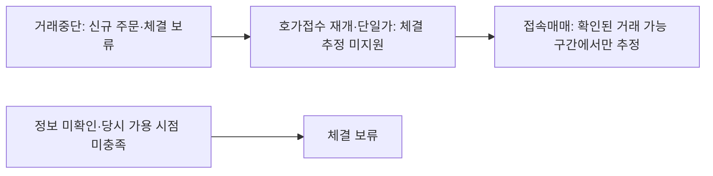

# 장중 거래중단·단일가 구간과 재현 엔진 연결

기준일: 2026-11-06. [추가 공지·세션 판단](../sessions/session-coverage-boundary-review.md)의 CB·사이드카 근거를 연구용 재현 엔진에 연결했습니다. **구간 모델·실제 근거 변환·주문/체결 제한·경계/시점 검증**의 네 작업을 수행했습니다. 5-08의 세션 근거를 재현에 연결하는 후속이며, 실제 가격/호가 대조를 포함한 5-09 전체 완료는 아닙니다.

## 동작 구조



`app.replay.intraday`의 불변 타임라인은 시장·한국 영업일·구간 시작/종료·`knownAt`·출처·원문 해시를 보존합니다. 구간은 **시작 포함·종료 제외 `[startAt,endAt)`**입니다.

| 구간 | 주문·체결 재현 |
|---|---|
| `HALT` | 해당 시장의 신규 주문안·일반 체결 보류. 취소 주문은 이 엔진의 지원 범위 밖 |
| `REOPENING_AUCTION` | 호가접수 재개와 접속매매를 구분. 단일가 체결 가격·대기열이 없어 체결을 생성하지 않음 |
| `PROGRAM_BUY_PAUSE` / `PROGRAM_SELL_PAUSE` | `PROGRAM`으로 명시한 해당 매수/매도 주문에만 적용. 일반 주문·반대 방향은 이 제한으로 막지 않음 |
| 확인된 정규장 안의 접속매매 | 해당 날짜의 완전성·가용 시점과 다른 조건까지 충족할 때 기존 분봉 시가 추정 적용 |
| 미확인 날짜/구간·늦게 확보한 자료 | `INTRADAY_COVERAGE_UNCONFIRMED`, 체결 없음 |

시장 전체 중단과 프로그램 호가 효력 정지는 겹칠 수 있지만 같은 사건으로 합치지 않습니다. 여러 제한이 겹치면 시장 전체 중단을 우선합니다. `ORDINARY/PROGRAM`은 사용자가 지정하는 재현 입력이며 AI 주문이라는 이유나 금액으로 자동 분류하지 않습니다. 한 실행의 모든 주문안에 같은 분류를 적용합니다.

## 실제 근거 연결

이전 검토 보고서·명세·목록·원문을 **네트워크 없이 재감사**한 뒤 타임라인을 생성합니다. 고정 효력일 범위는 2023-11-01~2026-11-02입니다.

| 자료 | 포함 |
|---|---:|
| 시장·날짜 | 100개, 모두 부분 근거 |
| CB 중단 | 17개 |
| CB 재개 단일가 | 17개 |
| 프로그램 호가 효력 정지 | 100개 |
| 전체 제한 구간 | **134개** |

CB는 목표 기간 안의 KOSPI 11·KOSDAQ 6개 시장/날짜를 연결합니다. 원문의 발동→해제 20분과 해제 후 10분 단일가를 각각 보존합니다. 사이드카는 KOSPI 99404/99405, KOSDAQ 70711/70710 양식에서 방향·본문 날짜/시각·5분을 추출하고 목록의 발표 날짜/시장과 대조합니다. 이전 검토의 사이드카 104개 중 목표 효력일 범위 밖 4개는 이번 타임라인에서 제외합니다. 범위 밖 CB 1쌍도 포함하지 않습니다.

[생성 명세](../../examples/intraday-evidence.json)는 선행 `session-decisions.json`의 SHA-256과 실제 생성 시각을 고정합니다. 타임라인의 근거 수준은 `EVIDENCED_PARTIAL`이고 모든 날짜의 `coverage=PARTIAL`, 정규장 `openAt/closeAt=null`입니다. **알려진 제한 구간을 확보했다고 그 밖의 시간을 실제 접속매매로 확정하지 않습니다.** 일반 후보 1,448개와 기존 ReferencePack은 계속 보존합니다.

## 엔진 연결과 시점 처리

연구 CLI의 `replay`에 타임라인 파일·예상 SHA-256·시장·주문 분류를 함께 지정합니다. 파일 바이트 해시·내부 `timelineId`·날짜/시장/중복/겹침/시각을 검증한 뒤 적용합니다. 누락된 선택 인자를 일부만 주면 실행하지 않습니다.

- 주문 판단 시각과 체결 후보 분봉 시작 시각에 각각 제한을 확인합니다. `knownAt`이 그 시각 이후인 구간의 종류·식별자·시각을 판단 결과에 노출하지 않습니다.
- 알려진 중단/단일가 구간이 분봉 일부라도 겹치면 일반 시가 체결로 추정하지 않습니다. 분봉 종료와 제한 시작이 정확히 같으면 겹치지 않습니다.
- 14:34:30에 호가접수가 재개됐다고 14:34 분봉을 접속매매 체결에 사용하지 않습니다. 10분 단일가가 끝난 뒤에도 확인된 완전성·가용 시점 조건이 필요합니다.
- 체결을 보류하면 현금·보유량·수수료·세금·분봉 유동성 사용량을 바꾸지 않습니다. 기존의 주문안당 한 번 시도·부분 잔량 취소 정책을 유지하며 재개 시점까지 주문을 자동 이월하지 않습니다.
- 실제 근거는 현재 확보·검토한 자료입니다. 이를 2024/2026년 당시 알고 있던 정보로 소급하지 않으며, 해당 과거 실행에서는 미확인으로 체결을 보류합니다.

완전한 거래 가능 구간의 긍정 경계 검증에는 **별도로 표시한 합성 타임라인**을 사용합니다. 실제 부분 근거를 `COMPLETE`로 바꾸는 입력은 거부합니다. 합성 타임라인에는 기존 `allowSynthetic=true`도 필요합니다.

타임라인을 적용한 보고서는 `engineVersion=R5_FOUNDATION_3`이고 `intradayPolicy`에 파일 해시·시장·주문 분류·미확인 시 체결 없음·단일가 미지원 정책을 기록합니다. `reportId`는 이 정책까지 포함합니다. **타임라인을 생략한 기존 실행은 `R5_FOUNDATION_2` 동작·바이트를 유지하며 장중 제한을 검증한 실행으로 해석하지 않습니다.** 가격 데이터셋·ReplayConfig 형식과 기존 보고서를 덮어쓰지 않습니다.

## 실행 예시

`AI/ai-server`에서 실행합니다. 실제 캐시는 Git 제외 경로 `research-artifacts/intraday-replay-20261106/`에 있습니다. 원문 감사에는 이전 작업 캐시와 절대 경로 계보도 필요합니다. 새 보고서의 출력 경로는 존재하지 않아야 합니다.

```powershell
$py = '.\.venv\Scripts\python.exe'
$timeline = 'research-artifacts/intraday-replay-20261106/timeline.json'

& $py -m app.replay replay --dataset '<분봉 데이터셋 경로>' --config '<주문안 설정.json>' --output '<새 보고서.json>' --intraday-timeline $timeline --timeline-sha256 876f349993f30ce428041f08f1e9a5a4d5355e0dbe725f6f6d8e856860788875 --market KOSPI --order-class ORDINARY
```

타임라인 재감사 명령은 다음과 같습니다. `build`로 새 파일을 만들고 `audit`로 기존 바이트를 대조합니다. 새 생성 시각·범위·판단을 사용하려면 새 명세·출력 경로를 사용합니다.

```powershell
& $py -m app.replay.intraday audit --scope ../../docs/examples/intraday-evidence.json --decision research-artifacts/session-coverage-20261106/session-decisions.json --parent research-artifacts/session-inventory-20261105/review-report.json --rules research-artifacts/kosdaq-rule-effective-20261105/report-v2.json --boundary-job research-artifacts/session-coverage-20261106/job --boundary-inventory research-artifacts/session-coverage-20261106/inventory.json --boundary-review ../../docs/examples/session-boundary-review.json --category-job research-artifacts/session-coverage-20261106/category-complete-job --category-inventory research-artifacts/session-coverage-20261106/category-inventory.json --category-review ../../docs/examples/session-category-review.json --output $timeline
```

## 검증과 완료 범위

최신 후속: [Windows 파일 게시 잠금 복구](../../operations/windows-file-publication.md)에서 원인을 격리 재현하고 제한 재시도·자료 보존을 추가했습니다. **기존 1,062건 + 신규 17건 = 전체 1,079건 통과**, 실패/오류/제외 0건입니다. 이전 11,082개 파일과 타임라인·기존 보고서·17개 재현 결과도 보존했습니다. 아래 간헐 실패 문단은 수정 전 기록이며 최신 검증 상태는 이 후속을 따릅니다.

장중 구간 신규 **44건 통과**입니다. 기존 재현 엔진 58건과 실패했던 기존 케이스 3건도 선별 실행에서 통과했습니다. 전체 회귀 대상은 1,062건이며 완주한 두 실행은 각각 **1,061건 통과·1건 실패**였습니다. Windows 파일 교체 `WinError 5` 및 기존 수집 테스트의 간헐 실패를 확인했으며, **전체 회귀 0실패로 표시하지 않습니다.** 마지막 전체 재시도는 다른 기존 파일 교체 실패에서 조기 중단됐고 로그를 보존합니다.

엔진 단위 테스트는 정규화한 메모리 입력으로 파일 게시 과정과 분리했고, CLI 통합 테스트는 실제 번들 생성·로드·해시 경로를 계속 검증합니다. 캐시 감사는 통신을 차단한 상태에서 기존 **10,968개 파일**과 신규 검증 산출물 **92개**의 해시를 보존했습니다. CB 17개 실제 시장/날짜와 **명시적 합성 가격**을 연결한 엔진 시나리오 17건에서 과거에 알려지지 않았던 구간을 노출하지 않고 체결·비용을 보류했습니다. 실제 과거 분봉/호가 체결 검증으로 계산하지 않습니다.

`develop`의 기존 엔진 코드를 별도로 실행한 결과와 타임라인 없는 새 엔진의 보고서 바이트가 일치했습니다. 기존 보고서 SHA-256은 `aa7d4e4c7b9393d404d00056829f1c9c599a1518e233b3a6f57ab5c952068177`입니다. 원문 근거·타임라인 재생성·시점/보존 결과는 `research-artifacts/intraday-replay-20261106/validation.json`에 기록합니다. 전체 회귀의 파일 교체 실패가 해소됐는지 확인하기 전에는 배포 준비 완료로 표시하지 않습니다.

타임라인 SHA-256은 `876f349993f30ce428041f08f1e9a5a4d5355e0dbe725f6f6d8e856860788875`, 내부 ID는 `2e014d76b7a3d8b1fde16856c4609749543638e35de303ba7f2e6592dd576dcb`입니다. 선행 판단 해시 `4afeb63678c80ac6521df34428c8d7e7949201ea87c88480f869dc2500c9b9dc`와 기존 원문/보고서의 해시를 보존합니다. 이번 작업은 신규 HTTP·유료 AI·계좌·주문 호출 없이 수행했습니다.

- [x] 시장/날짜별 중단·재개 단일가·프로그램 호가 정지 모델
- [x] CB 17쌍과 프로그램 호가 정지 100개의 실제 근거 연결
- [x] 주문 판단/체결 분봉의 제한·겹침·미확인 처리와 명시적 CLI 연결
- [x] 초·마이크로초 경계·시장/방향 분리·미래 정보·자원 보존 검증
- [x] [Windows 파일 게시 복구](../../operations/windows-file-publication.md)와 전체 회귀 1,079건·0실패 확인
- [ ] 전체 공지/장중 장애 누락·정정/철회·과거 가용 시점 확정
- [ ] 실제 호가·체결·단일가 가격/대기열·호가 단위·비용 대조
- [ ] 장기간 모의 운영과 [5-08의 다른 고정 조건](multi-company-reference-cases.md)

연구용 엔진 연결 범위는 완료했으며 **5-08 진행 중·5번 7/18·39%, 1~5번 26/48·54%**를 유지합니다. 다음 우선순위는 **실제 호가/체결 표본과 대조할 재현 검증 범위·입력 계약**입니다. 운영 배포·DB·EXE·학습·실주문은 변경하지 않았습니다.
