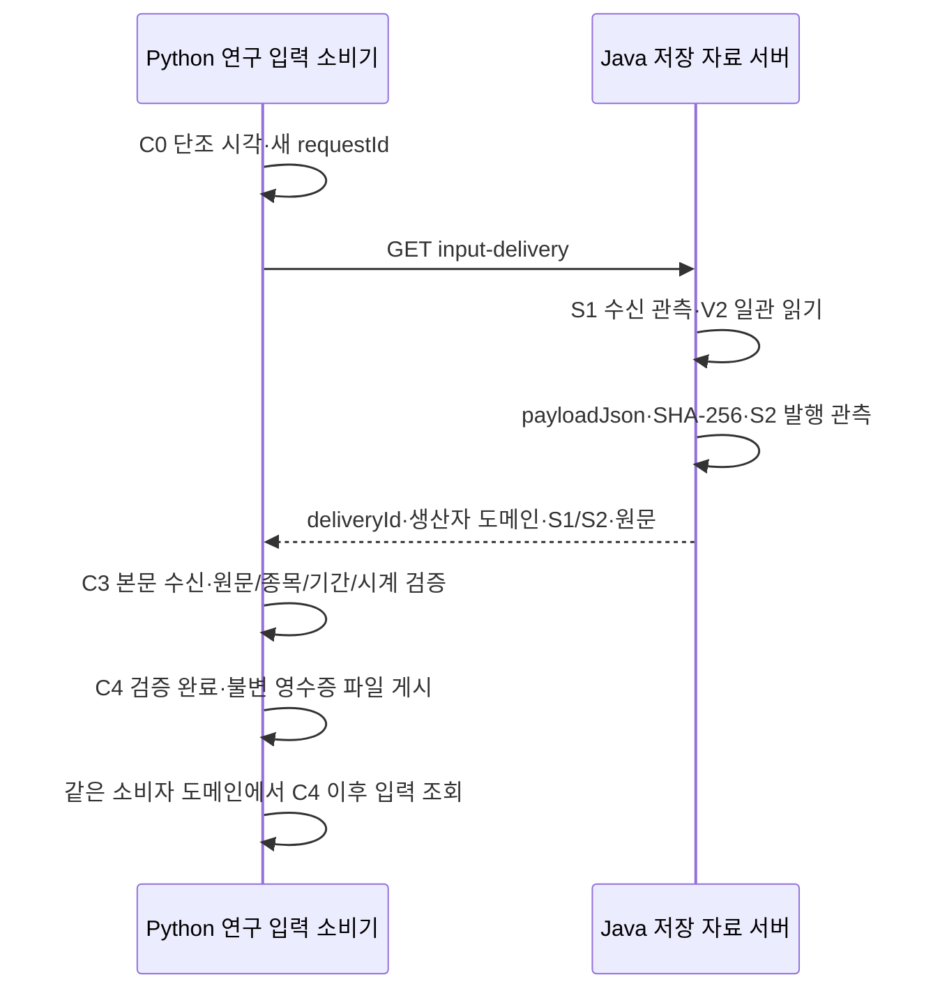

# 전략 연구용 입력 수신 기록과 프로세스 시계 연결

기준일: 2026-11-06. [U02](../project/remaining-development-units.md)의 **로컬 Python 연구용 입력 소비 경계**를 구현·검증했습니다. [U01의 로컬 캐시 공개](committed-input-availability.md)와 달리 이번 기록은 실제 Java HTTP 응답을 Python이 수신하고 원문·범위를 검증한 뒤 생성합니다. 학습 모델 전체·모델 판단 실행·주문 연결은 R6 이후 작업입니다.

## 경계와 전달 계약

기존 요청형 AI 분석은 일봉 기반이며 실시간 틱 입력 소비 경로가 없습니다. 이를 모델 수신 완료로 표시하지 않고, 별도 읽기 전용 연구 전달과 소비기를 연결했습니다.



`GET /api/v1/research/input-delivery?requestId=<요청별 UUID>&stockCode=005930&from=<UTC 분 경계>&to=<UTC 분 경계>`

- 기존 V2의 종료된 구간·분 단위 최대 24시간·행/원문 용량·REPEATABLE_READ를 따릅니다. 025/026/027이 필요하며 새 테이블은 없습니다.
- `SAGOPALGO_INPUT_DELIVERY_V1`: 요청별 `requestId`, 응답별 새 `deliveryId`, JVM의 `producerClockDomain`, `producerReceived`/`producerSent`, V2 `payloadJson`과 정확한 UTF-8 `payloadSha256`을 반환합니다.
- 시각 점은 `at`·`elapsedNanos`·`quality`입니다. 도메인은 프로세스 시작마다 변경되며 `utcSynchronized=false`를 고정합니다.
- 읽기 전용·no-store이며 Provider·계좌·주문·구독·모델을 호출하지 않습니다. 기존 V1/V2 API와 기존 분석 API는 유지합니다.
- [전달 스키마](../examples/strategy-input-delivery.schema.json)와 [연구 정책 스키마](../examples/strategy-input-receipt-policy.schema.json)를 버전 관리합니다.

Python은 `http://127.0.0.1:<port>`만 허용합니다. 프록시 환경변수·리다이렉트·인증정보가 있는 URL·다른 호스트를 사용하지 않습니다. 동일 기기의 신뢰하는 서버용이며 서명·원격 서버 인증 프로토콜은 아닙니다. 응답은 128MiB와 제한 시간 안에서 읽고, 실패 원문/서버 오류를 출력하지 않습니다.

## 시계 연결의 의미와 한계

C0/C3는 Python 요청 전/본문 수신 후, S1/S2는 Java 요청 처리 전/자료 직렬화 후의 **각 프로세스 시작 기준 단조 경과량**입니다. 원점을 같다고 가정하거나 양쪽 UTC 표기값을 직접 빼지 않습니다.

생산자 경과량 − 소비자 경과량의 원점 차이는 기본적으로 `[S2−C3, S1−C0]`에 놓입니다. 여기에 상대 속도 오차와 타임스탬프 오차 가정을 양방향으로 더합니다. 표시 상태는 **`BOUNDED_UNDER_RATE_ASSUMPTION`**이며 측정된 UTC 정확도 인증이 아닙니다.

| 연구 정책 | 기본값 | 의미 |
|---|---:|---|
| maxRoundTripMs | 2,000ms | 요청부터 본문 수신까지 상한 |
| maxUncertaintyMs | 200ms | 원점 차이 구간 폭 상한 |
| maxValidationMs | 2,000ms | 수신 이후 검증 완료까지 상한 |
| relativeRatePpm | 100ppm | 두 단조 시계의 상대 속도 오차 가정 |
| timestampErrorNs | 1,000,000ns | 시각 점당 오차 가정. ns 필드가 ns 정확도를 증명하지 않음 |
| mappingHorizonMs | 5,000ms | 공개 시각을 같은 도메인의 현재 교환으로 연결하는 최대 거리 |

현재 프로세스의 공개 관측은 원점 차이 구간으로 소비자 경과량 범위에 연결합니다. 기존 프로세스 도메인·공개 기록 없음·시계 변동·연결 범위 밖은 각각 별도 미확인 사유를 남깁니다. 오래된 관측을 현재 시계로 소급 변환하지 않습니다. 범위 안이라도 단조 속도/오차 가정에 따른 연구 결과입니다.

**자료를 소비할 수 있는 가장 이른 기록은 실제 Python 검증 완료 C4**입니다. 공개 시각의 연결 결과로 이를 앞당기지 않습니다. 전역 UTC 판단은 항상 `BLOCKED_UTC_UNCONFIRMED`, `usableForTrading=false`, `usableForStrategyValidation=false`입니다. 현재 단계에서 모델 실행은 `modelEvaluated=false`입니다.

## 차단·보존·재시작

- requestId 불일치·동일 deliveryId 재사용·같은 생산자 도메인의 순서 역전·원문 해시/타입/종목/기간 오류는 입력 공개 전에 거절합니다.
- 같은 생산자 도메인의 공개 관측이 발행보다 미래이거나 시각 표기와 경과량이 불일치하면 거절합니다.
- 교환 모순·왕복/불확실성/검증 지연 상한 초과·생산자/소비자 시계 변동은 **BLOCKED 영수증을 보존하고 자료는 공개하지 않습니다**. 빈 표본도 성공으로 올리지 않습니다.
- Python 재시작 시 도메인이 바뀌므로 기존 객체/영수증은 새 런타임 입력으로 사용할 수 없습니다. Java 재시작도 새 도메인으로 구분합니다. 원본 재전달은 새 수신이며 과거 첫 수신으로 기록하지 않습니다.
- 저장 완료 전에 입력 객체를 반환하지 않습니다. 폴더 게시 실패 시 전파하고, 기존 결과는 덮어쓰지 않습니다. 전원 장애에 대한 파일 시스템 fsync 보장이나 서버 측 ACK 원장은 이번 범위 밖입니다.
- 소비기는 단일 프로세스의 순차 실행 경로입니다. 다중 소비자 운영·영수증을 읽어 모델을 자동 재개하는 기능은 없습니다.

| 파일 | 내용 |
|---|---|
| source-response.json | 받은 HTTP JSON 본문 원본 |
| source-export.json | 해시 검증한 V2 원문 바이트 |
| config.json | 종목·기간·출처·활용 범위 선언 |
| receipt.json | request/delivery/receipt ID·원문/응답/설정 해시·두 도메인·C0/C3/C4/S1/S2·오차 범위·차단 사유·입력별 공개 연결 |
| records.json | 검증한 연구 입력. 원래 knownAt은 sourceKnownAt으로 보존하고 현재 소비자 도메인·경과량 기준 가용 시각 추가 |

단조 경과량과 도메인이 판단 기준입니다. records의 UTC 모양 `knownAt`은 동일 소비자의 시각 표기이며 전역 UTC가 확인됐다는 뜻이 아닙니다. 영수증은 새 런타임으로 입력을 자동 복원하는 재개 파일이 아닙니다.

## 실행

AI 서버 폴더에서 실행합니다. 운영 서버를 자동 재배포하거나 수집을 켜지 않습니다.

```powershell
.\.venv\Scripts\python.exe -m app.replay.input_receipts --base-url http://127.0.0.1:18081 --config tick-config.json --output research-artifacts/새-영수증-폴더
```

기존 `app.replay`의 오프라인 CLI는 네트워크 없이 유지합니다. 새 모듈만 명시적 로컬 HTTP 수신을 수행합니다. 종료 코드는 수신 허용 0, 기록은 남았으나 차단 1, 스키마/통신/파일 실패 2입니다. stdout에는 상태·식별자·건수만 출력합니다.

## 실제 전달 검증

### 기존 실제 자료 재전달과 실제 프로세스 재시작

기존 체결 1·호가 4건을 추가 공급자 호출 없이 새 Java 서버에서 4회 전달했습니다. Java 컨테이너와 Python 인터프리터를 실제 재시작해 생산자/소비자 도메인 각각 2개를 확인했습니다.

- 원문 5건 그대로 보존, 4회 합계 20행 전달이며 새 시장 이벤트 20건으로 계산하지 않습니다.
- 매회 C4 직전 0행·정확한 C4에서 5행, 다른 소비자 도메인에서 0행입니다.
- 과거 생산자 도메인 5건은 변환하지 않고 새 Python 수신 시각부터만 노출합니다.
- 최종 정책의 왕복 시간은 94~594ms, 오차 구간 폭은 약 71~91ms입니다. 장중 지연 성능 보장이 아닙니다.
- [건수·식별자·해시 요약](../examples/strategy-input-validation-20261106.json)을 보존합니다. 원문은 Git 제외 경로에 둡니다.

### 현재 수집 프로세스 → 실제 Python 수신

별도 삼성전자 체결/호가 **2구독·60초** 수집에서 종료된 1분 구간의 **체결 38·호가 85, 총 123건**을 받았습니다. 16:50~16:51 KST 부근 표본으로 정규 연속매매의 검증 결과로 승격하지 않습니다.

- 123건 모두 현재 Java 도메인의 불변 공개 관측과 연결했습니다.
- 해당 수신의 왕복 **141ms**, 오차 구간 폭 **103.263950ms**입니다. 시계 오차 가정과 글로벌 UTC 미확인을 함께 기록했습니다.
- 종료된 분 단위 자료를 사용하는 검증이므로 공개 연결 범위를 이 실행에 한해 **60,000ms**로 명시했습니다. 기본 5,000ms는 변경하지 않았습니다.
- C4 직전 0행·정확한 C4에서 123행입니다. 원래 공개 시각이나 공급자 시각으로 Python 수신을 앞당기지 않았습니다.
- 수집 초기의 아직 종료된 표본이 없는 요청은 BLOCKED로 남겼습니다. 이후 성공으로 덮어쓰지 않습니다.
- [신규 실제 수신 요약](../examples/strategy-live-input-validation-20261106.json)을 보존했습니다. raw 가격·수량은 로컬 연구 폴더에 남깁니다.

전체 60초 수집으로 추가된 이벤트는 **408건**이며 위 123건은 종료된 1분 구간의 수신 대조 표본입니다. 기존 **1,204건의 원문 해시 보존**, 과거 미관측 이벤트 소급 관측 0건, 전체 413개 공개 관측의 원문 해시 일치를 읽기 전용 DB 점검으로 확인했습니다. [보존 요약](../examples/strategy-input-preservation-20261106.json)을 따릅니다.

일회성 수집기·읽기 서버는 종료했고 임시 환경 파일을 제거했습니다. 운영 수집 OFF·기존 계좌/주문 설정을 유지합니다. DB 스키마 변경·실주문·외부 AI 전송은 없습니다. 신규 표본만 기존 025/027에 추가합니다.

## 검증 결과와 진행 판정

- 신규 Python **32건**: 수신 전/경계, 시계 오차 가정, 지연/역전/재시작, 중복·해시·원문 보존, 로컬 실제 HTTP·프록시/리다이렉트 차단, 게시 실패, 빈 표본 검사.
- 신규 Java **3건**: 정확한 ISO 원문·해시·요청/응답 식별자·도메인·순서, 입력 오류 무조회, no-store와 기존 오류 응답 유지.
- Java 전체 **738건 중 605건 통과·133건 조건부 제외·실패/오류 0건**. 관련 실제 MySQL 통합 검증 포함입니다.
- AI 전체 **1,196건 통과·실패/오류/제외 0건**, 기존 의존성 경고 1건입니다. 중간 타임스탬프 오차 가정 추가로 합성 모순 표본의 간격을 조정했고, Windows sandbox TEMP 접근 오류는 새 워크스페이스 basetemp로 해결했습니다. 테스트 생략·오류 무시는 없습니다.

**U02의 연구용 수신 기록·시계 연결은 완료**입니다. 신뢰 가능한 외부 UTC 동기화와 실제 모델 소비 검증은 남아 ①-06 전체를 체크하지 않습니다. 프로젝트 고정 **27/48·56%, 5번 7/18·39%, 5-08 진행 중**은 유지합니다. 다음 실행 단위는 **U03 공식 호가 단위 팩**이며, 모델 실제 소비는 M04 shadow와 연결합니다.
