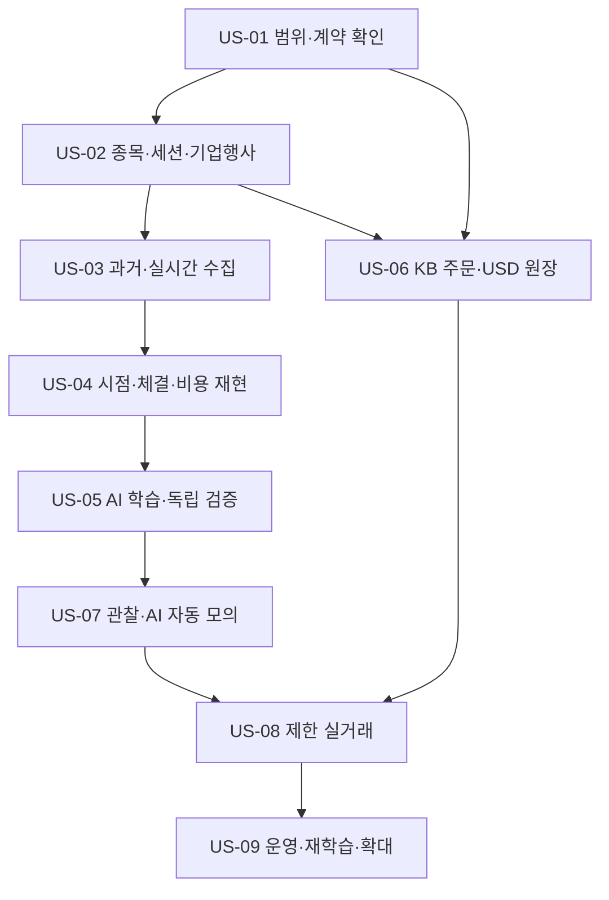

# 미국주식 AI 학습·자동매매 로드맵

미국주식 자동매매 확장 계획입니다. 국내 개발의 R0~R8·R10과 같은 검증 흐름을 따릅니다. 애플·엔비디아의 일봉 학습과 USD 수동 모의 범위는 1차 프로토타입에서 검증합니다. 미국주식 자동 운용 범위를 확정하면 보류 목록에서 이 계획을 재개합니다. [4종목 프로토타입](learning-prototype.md#실행-순서와-완료-기준) · [보류 작업](deferred-work.md) · [국내 개발 로드맵](realtime-trading-roadmap.md)

## 1. 출발점과 1차 운용 범위

| 영역 | SagoPalgo에서 확인한 기반 | 미국주식 자동매매에 필요한 확장 |
|---|---|---|
| 시세 | Spring·Flutter에서 NASDAQ·NYSE·NYSE American 종목정보, USD 현재가, 원주가 캔들을 KB → KIS → 토스 순서로 조회 | 학습·자동 판단에 쓸 데이터 이용 권한, 거래소 범위, 이벤트 시각과 지연이 검증된 과거 자료 및 실시간 체결·호가 수집. [미국주식 조회 계약](../contracts/api-spec.md#미국주식-종목정보현재가캔들-조회) |
| 모의매매 | 사용자가 티커·수량을 지정하면 조회한 현재가로 가상 체결. `paper_us_accounts`, `paper_us_trades`의 별도 USD 장부 및 요청 중복 방지 구현 | 보수적 체결 모형, 부분 체결·미체결·취소·비용, AI 신호부터 주문까지의 자동 모의. [USD 모의매매 계약](../contracts/api-spec.md#144-미국주식-usd-모의매매) |
| AI·연구 | Python의 규칙 기반 점수와 국내 R5 데이터셋·시점 재현 기반 | 미국 시장에 맞춘 특징·목표값, 독립 학습·검증, 재현 가능한 모델 및 실시간 추론. [R5 재현 도구](../historical-data/replay/historical-data-replay.md) · [R6 학습 계획](realtime-trading-roadmap.md#r6-학습-모델과-실시간-단기-전략) |
| 계좌·주문 | KB 계좌 관찰과 국내 온주 원화 지정가 수동 전송, 대조·복구 기반 | KB 미국 온주 주문·정정·취소 계약과 계좌 권한, USD 주문가능금액 및 체결·정산 대조. [증권사 API 계약표](../contracts/trading-api-contract-matrix.md) |

**1차 범위 제안**은 KB 해외주식 거래가 가능한 개인 계좌 1개, NASDAQ·NYSE 상장 보통주 중 검증된 소수 종목, 정규장, USD 현금 기반 온주 매수·보유분 매도, 지정가 DAY입니다. 초기 전략은 분봉을 사용한 장중 판단과 당일 청산을 검토합니다. 판단 주기, 최대 보유 시간, 신규 진입 마감, 잔여 포지션 처리, 자금·손실 한도는 US-01에서 확정합니다. NYSE American, ETF, 소수점, 공매도·신용, 프리·애프터·야간장, 자동환전은 별도 검증 후 확장합니다.

**역할**은 기존 구조를 따릅니다. Spring이 시장·계좌 자료, 자금 배분, 위험 검사, 증권사 전송·원장 대조를 담당합니다. Python은 과거 재현·학습·실시간 추론을 담당하고 신호와 근거를 반환합니다. Flutter는 시장별 운용 범위·상태·성과, 자동매매 ON/OFF와 중지 사유를 표시합니다. Ubuntu 서버가 앱 종료 중에도 수집·판단·복구를 담당합니다. [목표 아키텍처](../architecture/target-system-architecture.md)

## 2. 한눈에 보는 로드맵

| 순서 | 확인할 결과 | 다음 단계 진입 조건 |
|---|---|---|
| US-01 → US-02 | 시장·계좌·공급자 범위와 날짜별 거래 기준정보 | 데이터 사용 범위가 확인되고, 해당 시점의 종목과 주문 가능 구간을 재현할 수 있음 |
| US-03 → US-04 | 학습 입력, 실시간 수집, 체결·비용을 포함한 과거 재현 | 데이터 누락·지연과 체결 모형의 한계를 계량하고 같은 입력에서 같은 결과를 재현 |
| US-05 | 미국주식 모델과 기준선의 동일 조건 비교 | 보지 않은 미래 구간에서 사전 합의한 비용 포함 성과·위험·체결 기준 통과 |
| US-06 | KB 주문과 USD 계좌·체결·정산 대조 | 허용 범위에서 주문 상태 전이, 중복 차단, 미확정 전송 복구와 금액 대조 검증 |
| US-07 | 실시간 신호 관찰과 AI 자동 모의 운용 | 시세 → 판단 → 위험 검사 → 모의 체결 → USD 원장까지 검증 |
| US-08 → US-09 | 제한 실거래 및 운영 안정화 | 별도 실거래 승인 후 체결·잔고·결제까지 대조하고, 장애 복구와 중지 절차 검증 |

US-06은 US-01의 증권사 계약과 US-02의 필요한 종목·세션 규칙이 확인된 범위부터 연구 경로와 병행합니다. KB 실계좌 계약이 대기 중이면 권한이 확인된 데이터로 US-02~05와 US-07의 관찰·내부 모의를 진행할 수 있습니다. US-08은 US-06과 US-07이 모두 완료돼야 합니다.

## 3. 작업 순서와 완료 조건

### US-01. 운용 범위와 증권사·데이터 계약 확정

1. 대상 상장시장·상품·후보군 선정 방식, 현지 정규장, 판단 주기, 신호 유효기간, 최대 보유 시간 및 마감 전 진입 중단 정책을 결정합니다. 거래정지·미체결로 당일 청산에 실패할 때의 알림, 잔여 보유 처리, 재개 권한을 함께 정합니다.
2. KB 공식 계약에서 온주 주문·정정·취소, 주문가능 USD·매도가능수량, 잔고·미체결·체결 조회, 장 구분·거래소 코드, 가격 증분·유효시간, 호출 제한, 모의 환경, 인증·서버 IP 조건을 확인합니다. 공개 문서, 해당 계좌의 읽기 전용 응답, 모의 응답, 실거래 확인 근거를 각각 기록합니다. [KB Open API 문서](https://openapi.kbsec.com/apidoc_b2c)
3. 데이터 공급자마다 제공 기간·해상도, 실시간/지연, 통합 피드/개별 거래장 피드, 결측 보충, 호출·구독 예산 및 개인 서버 저장·과거 재현·모델 학습·화면 밖 자동 판단 권한을 확인합니다. 권한이 확인된 용도만 허용합니다. 외부 이메일 답변이 필요한 실행 단위는 문의 대상·질문·근거·재개 조건을 보류 문서에 기록합니다. [NYSE CTA 안내](https://www.nyse.com/data/cta) · [Nasdaq UTP 데이터 정책](https://www.utpplan.com/data_admin) · [보류 관리 기준](deferred-work.md#관리-기준)
4. 실험 전에 데이터 커버리지와 최신성, 비용 포함 성과·최대 낙폭·거래 표본 수·체결률, 주문/일일 손실 한도의 기준값을 평가 계획에 고정합니다. 실시간 모의와 제한 실거래의 관찰 기간·검증 거래 수도 단계별로 정합니다.

**완료 조건** — 운용 범위표, API/데이터 권한표, 평가 계획을 버전으로 저장합니다. 불확실한 계약마다 영향을 받는 작업과 필요한 증거를 명시합니다.

### US-02. 종목 식별·거래 세션·기업행사 기준정보 구축

1. 내부 종목 ID에 상장 거래소, 종목 종류, 거래 통화, 기간별 티커와 공급자 코드, 상장·폐지·이전상장·합병 이력을 연결합니다. 티커 재사용과 주식 종류를 구분합니다. 과거 후보군은 해당 거래일 당시의 상장·유동성 조건으로 재구성하고, 이후 상장폐지된 종목의 이력도 포함합니다. [Nasdaq Daily List](https://classic.nasdaqtrader.com/Trader.aspx?id=DailyListPD)
2. `America/New_York` 기준 거래일과 세션 경계, UTC 이벤트 시각, `Asia/Seoul` 표시 시간을 보존합니다. 일반 정규장은 09:30~16:00 ET로, 한국 표시 기준 서머타임에는 22:30~다음 날 05:00, 표준시에는 23:30~다음 날 06:00입니다. 거래일별 공식 휴장·조기폐장·임시 변경과 증권사 주문 허용 시간을 함께 적용합니다. 거래일 달력과 결제일 달력을 각각 관리합니다. [NYSE 거래시간·일정](https://www.nyse.com/trade/hours-calendars) · [Nasdaq 거래 달력](https://www.nasdaqtrader.com/trader.aspx?id=Calendar) · [Nasdaq 개장·마감 경매](https://www.nasdaqtrader.com/Trader.aspx?id=OpenClose)
3. 거래정지·재개, LULD 종목별 가격 밴드·거래 일시정지와 시장 전체 서킷브레이커의 적용 구간을 수집합니다. 분할·역분할·배당·합병·상장폐지의 발표·정정·효력·기준·지급 시각을 역할별로 기록합니다. 당시 가용했던 사건 버전과 가격 조정 근거를 별개로 보존합니다. [LULD Plan](https://www.luldplan.com/) · [Nasdaq 거래정지 조회](https://www.nasdaqtrader.com/trader.aspx?id=tradinghaltsearch)

**완료 조건** — 티커 변경·재사용, 상장폐지, 분할·배당, 정지와 재개, 휴장·조기 종료, 서머타임 전환 표본을 원문과 대조합니다. 범위를 확인할 수 없는 종목·일자·구간은 사유를 표시하고 주문 판단에서 제외합니다.

### US-03. 과거 자료와 실시간 체결·호가 수집

1. 당시 후보군의 USD 원주가 OHLCV, 거래·호가 자료와 기업행사, 시장·업종 지표를 확보합니다. 일봉은 장기 추세·후보군 연구에 쓰고, 분봉은 장중 특징에, 시각·수량이 있는 호가와 체결은 체결 가능성 추정에 사용합니다. 장중 해상도·범위가 부족하면 전략 주기와 모의 검증 범위를 자료 수준에 맞춥니다.
2. Spring 수집 경로에 미국 피드 어댑터와 종목별 구독 예산을 붙입니다. 호가 범위, 정규장 여부, 원천 이벤트 시각, 공개·가용 시각, 수신 시각, 출처, 순번·정정 여부를 분리해 저장합니다. 끊김 이후 누락 구간, 중복, 순서 역전, 지연과 보충 가능 여부를 표시합니다. 앱 조회의 대체 공급자는 같은 종목·세션·가격 기준·지연이 자동 판단 계약을 충족할 때만 사용합니다. [기존 실시간 수집 경로](../market-data/realtime-data-pipeline.md)
3. 공시 특징을 쓸 경우 SEC EDGAR 접수·공개 근거와 발행사 자료를 수집하고 정정 계보를 연결합니다. 뉴스·실적 일정은 원문 이용 권한과 실제 공개 시각을 확인합니다. USD 손익의 KRW 환산에 쓸 환율은 가격·시각·출처를 붙여 별도 보관합니다. [SEC EDGAR API](https://www.sec.gov/search-filings/edgar-application-programming-interfaces)

**완료 조건** — 기간×종목×데이터 종류별 커버리지와 품질 보고서, 원본 해시·정규화 규칙이 포함된 데이터 매니페스트를 만듭니다. 샘플 장중 데이터에서 원본 대조, 재연결, 중복 제거, 단절 감지, 재처리 시 동일 결과를 검증합니다.

### US-04. 주문 판단 당시의 시장과 체결·비용 재현

1. Python 재현 도구에 미국 기준정보와 가격·이벤트를 연결합니다. 판단 시각에 이용 가능했던 데이터만 특징에 넣고, 소급 정정·조정 및 이후 확정된 종목군이 과거에 들어가는지 검사합니다. 원주가를 주문·현금 원장에 사용하고, 분석용 조정 시계열은 사건과 적용 방식·시각을 별도로 기록합니다.
2. 지정가의 가격·수량·유효기간, 신호부터 주문 도착까지의 지연, 호가 스프레드·유동성·잔량, 거래정지·조기폐장, 부분 체결·미체결·취소를 구현합니다. 봉의 고가·저가 통과는 체결 후보 근거로만 사용합니다. 체결 순서나 수량 근거가 부족하면 미확정 또는 보수적 시나리오로 평가합니다.
3. USD 원장에서 거래 수수료·적용 비용과 슬리피지를 날짜·주문 방향별로 적용합니다. 환전은 실제 환전이 있는 USD/KRW 평가 시나리오에 반영하고, 배당과 원천징수는 해당 현금 이벤트에서 처리합니다. 비용과 환율 가정의 기준일·출처를 기록하고 스프레드·지연을 높인 스트레스 결과도 산출합니다.

**완료 조건** — 같은 데이터·정책 버전에서 주문·체결·USD 원장·비용 보고서를 재생성합니다. 정지 중 체결, 봉 확정 전 사용, 가격을 벗어난 지정가 체결, 잔량보다 많은 체결을 막는 표본을 대조합니다.

### US-05. 미국주식 모델 학습과 독립 평가

1. 국내 공통 특징의 정의는 재사용 가능성을 검토하고, 미국 정규장 기준 시간대·거래량, USD 수익률, 업종 대비 움직임, 호가 스프레드, 공시·실적 사건을 미국 데이터로 계산합니다. 예측 기간과 목표값을 먼저 고정합니다. 예를 들어 10:05 ET에 봉이 마감되고 시세가 실제로 도착한 뒤 신호를 만들며, 이후 주문이 도착한 시점부터 가능한 진입·청산 체결과 비용으로 순손익을 계산합니다. 미체결은 별도 결과로 정의합니다.
2. 규칙 기반 기준선과 단순한 학습 모델을 동일 후보군·체결 모형·비용·한도로 비교합니다. 날짜 순서대로 학습→검증 구간을 이동하며, 목표 구간이 경계와 겹치는 표본을 제거하고 필요한 간격을 둡니다. 정규화와 특징 선택은 학습 구간에서만 적합하고, 최종 평가 구간은 모델과 기준값이 확정된 뒤 사용합니다.
3. 순손익·최대 낙폭·회전율·체결률, 종목과 장세별 성과, 비용·슬리피지 민감도 및 표본 수를 보고합니다. 데이터·특징·목표값·비용·모델·전략 설정·실행 버전을 묶어 등록하고 승인 버전과 복구 대상을 지정합니다. [국내 R6 모델·버전 관리](realtime-trading-roadmap.md#r6-학습-모델과-실시간-단기-전략)

**완료 조건** — 독립 최종 구간에서 US-01의 기준을 충족하고 평가를 재현합니다. 미달하면 데이터·라벨·체결 가정의 원인을 확인한 후 새 평가 계획으로 US-03~05를 반복합니다.

### US-06. KB 해외 주문·계좌와 USD 원장 연결

1. Spring에서 KB 해외 온주 계약에 맞춰 연결합니다. 계좌와 환경, 원주문 번호, 거래소, 통화·가격 증분·온주 수량, 세션·주문 유효시간과 정정·취소 가능 상태를 검증합니다. 실계좌 읽기 대조와 허용된 증권사 모의 또는 격리 전송 검증을 순서대로 수행합니다.
2. 주문 의도·전송 기록을 저장하고 접수, 거래소 응답, 부분체결, 완료, 거절, 취소·만료 및 결과 미확정을 구분합니다. 타임아웃 후 재전송 전에 증권사의 주문·미체결·체결을 대조합니다. 부분 체결과 취소가 교차하거나 재시작하는 경우에도 체결 번호·잔량·예약 금액을 한 번만 반영합니다.
3. 현금 잔고, 결제된 현금, 증권사가 반환한 USD 주문가능금액, 미결제 매수·매도대금, 예약 금액을 분리합니다. 미국의 일반적인 표준 결제는 2024-05-28부터 T+1이며, 과거 재현에는 거래일 당시 규칙을 사용합니다. KB 계좌의 실제 결제·재사용 가능금액·환전 처리 시점은 KB 응답 및 거래명세서와 대조합니다. [SEC T+1 적용 FAQ](https://www.sec.gov/exams/educationhelpguidesfaqs/t1-faq)

**완료 조건** — 읽기 대조와 격리 환경에서 접수·부분 체결·거절·정정·취소·통신 단절·재시작·당일 마감 표본을 검증합니다. USD 현금·미결제·보유·체결 수량과 통화별 손익이 일치하고 불일치 시 신규 주문이 차단됩니다. 실제 전송·결제에만 확인 가능한 항목은 US-08의 승인된 검증 대상으로 남깁니다.

### US-07. 실시간 신호 관찰과 AI 자동 모의 운용

1. 실시간 수신 → 특징 → Python 추론 → Spring 배분·위험 검사 → 모의 주문 → 체결·원장·화면을 연결합니다. 과거 재현과 동일한 특징 정의와 단위를 쓰고, 같은 입력이 같은 신호·유효기한을 반환하는지 대조합니다. 결정 기록에 종목·시장·통화, 입력 기준 시각, 모델·특징·전략 버전과 주문 또는 판단 보류 사유를 남깁니다.
2. 최초에는 **실시간 관찰(shadow)** 모드로 주문 후보·예상 수량·보류만 기록합니다. 다음에는 US-04의 체결 모형으로 **AI 자동 모의**를 실행합니다. 신호 만료·시세 지연·차단 상태, 조기폐장과 종목 정지, 모델 장애, 연결 복구, 부분 체결 및 마감 후 대조를 검증합니다.
3. Spring에서 시장·계좌·전략별 기본 OFF, 종목 허용 목록, 종목·일별 주문액과 총 노출·일일 손실·미체결 수 한도를 검사합니다. 중지 시 신규 전송을 차단하고 기존 미체결의 취소·체결 상태는 대조가 끝날 때까지 추적합니다. Flutter에 운용 모드, 마지막 판단 시각, 데이터 상태, 거절·중지 사유, USD 원장과 평가손익을 표시합니다.

**완료 조건** — 정해진 관찰 기간과 거래 표본에서 실시간 입력 품질·체결 편차·비용 포함 성과·위험 기준을 충족하고, OFF·복구·동시 주문·장 마감 테스트에서 중복 주문과 한도 초과가 없습니다.

### US-08. 별도 승인 후 제한 실거래

1. US-06·07 통과 이후 계좌, 종목, 운용 기간, 금액·손실 한도, 주문 유형과 장애 시 담당 절차를 명시해 실거래를 승인받습니다. 허용된 최소 범위에서 실주문·정정/취소·체결·결제 중 모의로 확인할 수 없었던 계약을 검증한 뒤 그 범위 안에서 자동 운용을 활성화합니다.
2. 실제 주문·체결·수수료·USD 현금·보유·정산을 KB 명세서와 거래일별로 비교합니다. 모의 대비 슬리피지·체결률·지연 편차를 측정합니다. 미확정 주문, 원장 차이, 한도 위반 또는 시세 단절 시 신규 주문을 중단하고 미체결·보유를 대조한 후 명시적으로 재개합니다.

**완료 조건** — 승인 범위 내 체결→결제→일별 원장 대조가 끝나고, 운영 기준을 충족합니다. 관찰 기간에 실제 발생하지 않은 장애는 격리 복구 시험의 증거와 구분합니다.

### US-09. 운영 안정화, 재학습과 범위 확대

1. 서버 재시작·야간 장애의 자동 차단, 세션별 점검·알림, 모델·전략 롤백, 원장 불일치 대응과 수동 복구를 운영 절차서에 정리합니다. USD 순손익·비용·현금흐름과 KRW 환산 금액·환율 효과를 각각 표시합니다.
2. 데이터 분포 변화, 신호 빈도, 체결 품질, 비용 포함 성과를 모니터링합니다. 재학습 후보는 독립 평가와 실시간 관찰을 다시 통과한 버전만 승인하며 배포 전 버전으로 즉시 복구할 수 있게 합니다.
3. 지원 종목 수, 증권사 한도, 거래 세션, 상품을 한 범위씩 확대합니다. 추가 세션·소수점·자동환전은 각각의 유동성, 주문·취소, 정밀도·결제 계약 및 모의·제한 운영 결과를 바탕으로 도입합니다.

**완료 조건** — 정해진 운영 기간 동안 모니터링과 일별 대조를 수행하고, 중지·재시작·모델 롤백 훈련을 재현합니다. 확대 항목마다 범위별 승인과 검증 기록을 남깁니다.
