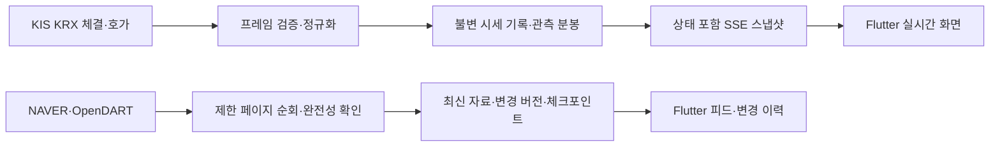

# R2·R3 실시간 시세와 증분 연구 수집 기반

2026-11-06 운영 후속: [실제 틱 수집 장애 복구](public-tick-collection-recovery.md)에서 메인 DB 백업 후 025/026의 6개 테이블을 적용하고 공개 API 200을 확인했습니다. 별도 1종목/2구독 실키 시험으로 체결 946·호가 135행을 저장·입력 대조하고 종료했습니다. 기존 서버의 수집 OFF·설정은 유지합니다. 아래는 2026-11-03 최초 구현 당시 범위이며 대규모/장기 운영·수급·복구 검증은 계속 남습니다.

기준일: 2026-11-03 · 구현/모의 HTTP·WebSocket 콜백·격리 MySQL·Flutter 검증 단계입니다. 실제 KIS 소켓 연결·권한/한도·장중 부하·운영 025/026 적용·배포는 별도 확인입니다. 새 기능은 기본 OFF이며 기존 KB 계좌 수집과 주문 스위치를 변경하지 않았습니다.

## 이번에 연결한 흐름



R2는 KIS의 KRX 공개 체결과 10단계 호가를 받는 단일 서버 연결입니다. 계좌 체결 통보·NXT·통합 시세·기관/외국인/개인 수급은 이 스트림에 포함하지 않습니다. 수급은 `NOT_SUBSCRIBED`로 명시하며 매수/매도 체결량을 투자자별 수급으로 바꾸지 않습니다. 현재는 서버 설정의 명시적 6자리 종목 목록 최대 10개를 사용하며 보유/관심목록 변경의 자동 구독 편입은 후속입니다.

R3는 기존 뉴스·공시 동기화의 명시적 증분 모드입니다. 설정 OFF에서는 기존 첫 페이지 수집과 최신 자료 목록을 유지합니다. 증분 모드에서만 페이지 완전성·중첩 재조회·변경 버전·체크포인트를 추가합니다. 기존 외부 수집 cron을 임의로 빠르게 바꾸지 않습니다.

## R2 공급자 계약과 상태

[KIS 공식 실시간 함수 예제](https://github.com/koreainvestment/open-trading-api/blob/main/examples_user/domestic_stock/domestic_stock_functions_ws.py)의 H0STCNT0/47필드와 H0STASP0/63필드를 기준으로 확인했습니다. [접속 예제](https://github.com/koreainvestment/open-trading-api/blob/main/examples_user/domestic_stock/domestic_stock_examples_ws.py)와 [인증 예제](https://github.com/koreainvestment/open-trading-api/blob/main/examples_user/kis_auth.py)의 승인키·구독 응답·PINGPONG 계약을 사용합니다.

- 승인키는 공식 운영 HTTPS `/oauth2/Approval`에서 발급받아 메모리에만 보관합니다. 시세 소켓은 공식 예제의 `ws://ops.koreainvestment.com:21000/tryitout`입니다. 이 연결 방식까지 확인한 계정/환경에서 활성화합니다. 키·시크릿·승인키·수신 원문·외부 오류 메시지를 로그나 API에 복사하지 않습니다.
- WebSocket 접속 성공은 LIVE가 아닙니다. 설정 종목의 체결/호가 구독 응답을 확인한 뒤 두 종류의 자료가 모두 최신일 때만 LIVE입니다. 누락·거절·잘못된 프레임은 고정 진단 코드로 구분합니다.
- 재접속은 지연을 늘리며 최대 8회 연속 연결 실패에서 중단합니다. 접속 후 구독은 1초 간격으로 순서대로 보냅니다. 연결/데이터 단절은 60초 watchdog, 구독 응답 미확정은 별도 시간 제한으로 처리합니다. 재접속 세대가 바뀌면 이전 콜백의 수신/실패가 새 연결을 변경하지 않습니다.
- 프레임 분할을 합쳐 검증하고 최대 256KiB·배치 100건을 제한합니다. 암호화 계좌 통보와 모르는 TR은 거절합니다. 잘못된 날짜·미래 시각·음수/부동소수 입력·잘못된 수량을 정상 0으로 바꾸지 않습니다.
- 체결에는 공급자 영업일과 체결시각을 사용합니다. 호가에는 영업일이 없어 한국 수신 날짜를 사용하고 `RECEIVE_DATE_INFERRED`로 표시합니다. 자정을 넘겨 해석이 모순되는 프레임을 임의 날짜 보정으로 수용하지 않습니다.
- 수치의 API 표현은 십진/정수 문자열입니다. 체결 식별자는 종목·영업일·누적 거래량으로 만들며 같은 식별자의 가격/수량 충돌을 차단합니다. 재수신으로 최신 수신 시각을 덮어쓰거나 분봉 거래량을 중복 가산하지 않습니다.
- 분봉은 관측한 체결만 집계한 `OBSERVED_ONLY`입니다. 거래/분봉 저장은 같은 트랜잭션이고 시간·누적 거래량 순서로 시가/종가를 결정합니다. 지연 도착도 집계하지만 과거 전체 거래가 복구됐다고 표시하지 않습니다.
- 현재 구현은 하나의 Spring 수집 프로세스를 전제로 합니다. 이벤트 중복 방지는 다중 WebSocket 연결 권한·분산 구독 소유권을 보장하지 않습니다. 복제 서버 운용은 분산 소유권과 공급자 중복 접속 계약 검증 전에는 지원 범위가 아닙니다.

설정 예시는 실제 계정의 권한·구독 예산을 승인한 값이 아닙니다.

```dotenv
SAGOPALGO_MARKET_STREAM_ENABLED=false
SAGOPALGO_MARKET_STREAM_RIGHTS_CONFIRMED=false
SAGOPALGO_MARKET_STREAM_APPROVED_SUBSCRIPTIONS=0
SAGOPALGO_MARKET_STREAM_SYMBOLS=
SAGOPALGO_MARKET_STREAM_STALE_SECONDS=15
```

활성화에는 KIS REST 설정/키와 위 권한 확인, 종목별 체결·호가 2개씩의 구독 예산이 필요합니다. 구현의 종목 10개/설정 예산 40개 상한은 계정의 허용 한도를 뜻하지 않습니다. 다른 프로그램의 구독도 포함해 확정합니다. 025 저장소를 사전 확인하지 못하면 승인키 발급·연결 전에 중단합니다.

## R2 API와 앱

- `GET /api/v1/market/realtime?stockCode=005930`: 저장 관측과 연결/최신 상태, 체결·호가, 최근 2시간 내 최대 120개 관측 분봉을 반환합니다. API 자체가 KIS를 조회하거나 구독 종목을 추가하지 않습니다.
- `GET /api/v1/market/realtime/events?stockCode=005930`: `event: snapshot` SSE를 약 1초마다 보냅니다. 증분 틱의 재생 로그가 아니라 최신 화면 스냅샷입니다. no-store와 X-Accel-Buffering=no를 사용하고 연결은 60초 후 끝나며 앱이 다시 연결합니다. 연결 상한 10개·제한된 송신 큐로 느린 클라이언트가 무제한 누적되지 않게 합니다.
- 앱은 보유 종목의 기존 일/주/월봉 화면 상단 `실시간 체결·호가` 아이콘으로 진입합니다. 10단계 호가·가격·제공/수신 시각·관측 분봉을 표시합니다. OFF/구독 대상 아님/연결 중/구독 대기/수신 대기/지연/실패를 구분합니다.
- 화면 종료 시 HTTP 스트림·재접속 타이머를 취소합니다. 끊김/형식 오류는 원문 없이 안내하고 이전 가격을 현재 가격으로 표시하지 않습니다. 화면 수신 지연과 서버 시각도 확인하므로 서버/앱 시계 동기화가 필요합니다. 날짜가 추정되거나 누락 구간이 있을 수 있어 항상 `usableForTrading=false`, `gapDetected=true`입니다.

## R3 페이지·체크포인트·변경 기록

[NAVER API HUB 뉴스 규격](https://api.ncloud-docs.com/docs/naver-api-hub-search-news)의 페이지/정렬/검색 범위와 [OpenDART 공시검색 규격](https://opendart.fss.or.kr/guide/detail.do?apiGrpCd=DS001&apiId=2019001)을 기준으로 처리합니다.

```dotenv
SAGOPALGO_RESEARCH_INCREMENTAL_ENABLED=false
SAGOPALGO_RESEARCH_INCREMENTAL_MAX_PAGES=3
SAGOPALGO_RESEARCH_INCREMENTAL_OVERLAP_DAYS=2
```

- NAVER의 display, OpenDART의 page-count는 기존 설정을 사용합니다. 최대 페이지는 1~10이며 NAVER 검색 시작 상한도 지킵니다. 페이지 상한·중간 HTTP 오류·반복 페이지·메타데이터 누락/변경·날짜 불명·내용 충돌을 PARTIAL로 남기고 이미 얻은 자료는 보존합니다. 같은 페이지를 자동 재시도하지 않습니다.
- 정상 범위 판정은 검색 결과의 범위에 한정합니다. 검색 엔진이 제공하지 않는 기사, 검색 상한 밖의 과거 전체 뉴스, 모든 정정 공시의 누락 없음을 보장하지 않습니다. 조회 범위/종료 근거를 확인한 공급자만 체크포인트를 갱신합니다.
- 기본 날짜의 반복 동기화는 공급자·종목·검색어별 이전 확인일에서 중첩 기간을 다시 조회합니다. 커서가 없으면 기존 기본 조회 기간으로 시작합니다. 장기간 중단된 커서를 기본 lookback에 맞춰 앞으로 잘라 미수집 기간을 조용히 건너뛰지 않습니다. 페이지 한도에 계속 걸리면 계속 PARTIAL이며 호출 예산/수집 범위를 검토해야 합니다.
- `providers[].pagesRead/complete/fromDate/toDate`는 해당 공급자의 실제 조회 범위와 페이지 확인 상태입니다. 통합 응답의 조회 기간은 저장 자료 표시 범위이고 공급자별 완전성과 같지 않을 수 있습니다. 명시적 과거 조회는 반복 수집 체크포인트를 진전시키지 않습니다.
- 동일 URL 뉴스의 제목/요약 등과 동일 접수번호 공시의 내용 변화를 버전으로 보존합니다. A→A는 새 버전을 만들지 않고 A→B→A는 세 버전으로 남깁니다. 기존 행을 처음 변경할 때 이전 자료를 `LEGACY_BASELINE`으로 보관하지만 과거의 실제 수신 시각을 만들어내지 않습니다.
- 별도 접수번호의 정정 공시는 별도 자료입니다. 목록 제목만으로 원공시 부모 관계나 내용 전체를 추정하지 않습니다. 중첩 조회 밖에서 뒤늦게 바뀐 과거 자료는 별도 재조회 없이는 발견을 보장하지 않습니다.
- 최신 자료·버전·체크포인트는 같은 트랜잭션입니다. 저장이 실패하면 모두 롤백합니다. 전역 저널 잠금을 짧은 DB 저장 구간에만 잡아 변경 ID와 커밋 순서를 일치시키고 외부 HTTP 호출 중에는 잠금을 유지하지 않습니다.
- `GET /api/v1/research/changes?stockCode=005930&afterId=0&limit=100`은 불변 버전을 기록 순서로 읽습니다. `nextAfterId`로 다음 페이지를 확인하며 원문 뉴스·공시를 다시 조회하지 않습니다. 비활성 시 enabled=false·빈 items를 반환합니다. 새 이력은 기존 자료의 무제한 과거 버전을 복원하지 않습니다.
- 앱 소식 탭의 저장 자료는 활성 탭에서 30초마다 GET으로 확인합니다. 외부 공급자 동기화 POST를 자동 반복하지 않습니다. `뉴스·공시 변경 이력`에서 버전·서버 기록 시각과 공급자 제공 날짜를 따로 확인합니다. 외부 수집 속도는 기존 수집 cron·권한/한도에 달려 있으며 화면 갱신 주기와 다릅니다.

## DB·배포·검증

기존 DB는 백업 후 [025](../Back/database/migrations/025_market_stream.sql)와 [026](../Back/database/migrations/026_research_incremental.sql)을 적용해야 합니다. 신규 schema.sql에도 같은 정의를 포함했습니다. 이번 개발은 운영 DB/환경/이미지의 자동 적용·재배포를 수행하지 않았습니다. 기존 계좌 관찰 023/024와 주문 원장은 변경하지 않습니다.

| 마이그레이션 | 저장 범위 |
|---|---|
| 025 | 공개 시세 이벤트와 관측 분봉 2개 테이블 |
| 026 | 커밋 순서 시퀀스·자료별 버전 head·불변 변경 버전·공급자 체크포인트 4개 테이블 |

데이터 자동 삭제/보관 기한은 아직 추가하지 않았습니다. 실제 실시간 수집을 켜기 전에 디스크/DB 용량·보관/백업 정책도 정합니다. 저장소 장애나 식별자 충돌은 연결을 실패 상태로 중단하며 운영자가 저장소·설정을 확인한 뒤 재시작합니다. 오래된 값을 새 시세로 조용히 대체하지 않습니다.

격리 검증은 [전용 Compose](../Back/spring-server/compose.market-research-test.yml)의 루프백 33318·고정 DB 이름·마커·tmpfs를 사용합니다. 실제 API 키와 운영 볼륨은 주입하지 않습니다.

```powershell
docker compose -f compose.market-research-test.yml up -d --wait
# 이 플래그는 전용 DB 이름과 마커 검사를 통과한 통합 테스트만 엽니다.
$env:SAGOPALGO_MARKET_RESEARCH_MYSQL_TEST='true'
./gradlew.bat test --tests '*MarketResearchMysqlIntegrationTest'
docker compose -f compose.market-research-test.yml down
```

실행 결과는 [진척도](development-progress.md)를 따릅니다. 실제 WebSocket/뉴스 부하와 지연, 공급자 지연 자료·장 마감/휴일·장시간 재접속·다중 프로세스·복구 backfill·수급 연결은 후속입니다. 테스트 합격을 실환경 운용 완료로 표시하지 않습니다.
