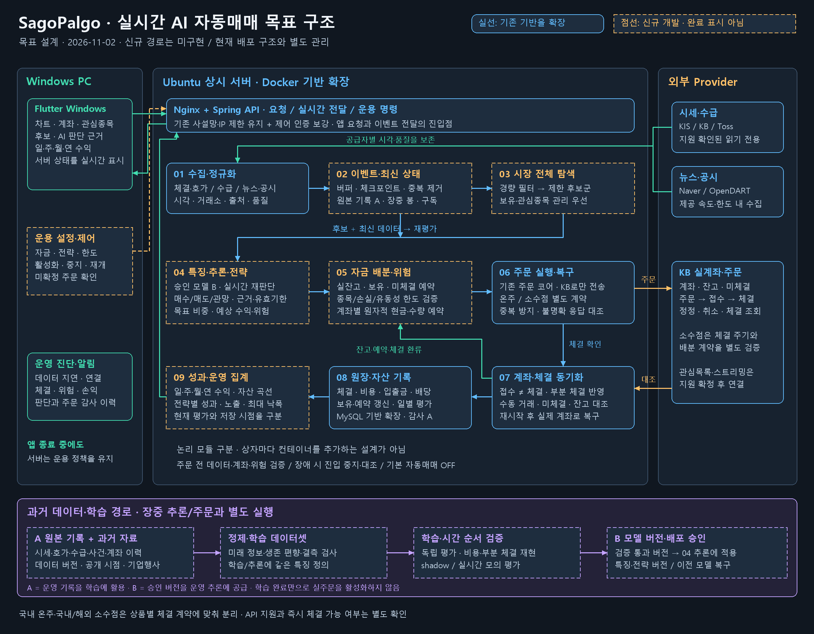

# 실시간 AI 자동매매 목표 아키텍처

기준일: 2026-11-02 · **목표 설계**. 그림에 있는 신규 경로는 아직 구현·배포되지 않았습니다. 개발 순서·완료 조건은 [최신 개발 로드맵](realtime-trading-roadmap.md), 현재 실행 환경·포트·볼륨은 [Docker 구조](docker-architecture.md)를 기준으로 합니다.

## 1. 현재 구조와 목표 구조의 관계

현재의 Windows Flutter 앱 + Ubuntu Docker Compose(Spring/Python/MySQL/Nginx)를 기반으로 확장합니다. 아래 그림의 실선 상자는 기존 기반을 확장하는 영역, 점선 상자는 신규 개발 영역입니다. **실선 상자도 내부의 목표 기능 전체가 완료됐다는 뜻은 아닙니다.** 현재 구현 범위와 남은 검증은 [개발 진척도](development-progress.md)에 따로 기록합니다.

[수정 가능한 SVG 원본](images/target-system-architecture.svg) · 재생성: `python scripts/render-target-architecture.py` (저장소 루트에서 실행, Python과 Pillow 필요). 스크립트는 같은 배치·문구로 SVG와 PNG를 생성하며 외부 API에 접속하지 않습니다.

현재 배포 이미지는 [기존 구조도](images/system-architecture-ubuntu.png)로 유지합니다. 목표 이미지를 현재 Docker 구성으로 오인하지 않도록 기존 이미지를 덮어쓰지 않습니다.

## 2. 구성요소와 책임

| 영역 | 책임 | 현재 기반 / 추가 범위 |
|---|---|---|
| Flutter Windows | 실시간 차트·계좌·후보·판단 근거·기간별 성과, 운용 설정·중지 | 기존 화면 확장, 이벤트 구독·운용 제어 신규 |
| Nginx + Spring API | UI 요청과 실시간 이벤트 전달, 운용 명령 인증/권한·감사 | 기존 프록시/API 확장, WebSocket/SSE·운용 제어 보강 |
| 계좌 동기화·체결 대조 | KB 잔고·미체결·체결·외부 수동 거래와 내부 상태 대조 | 기존 KB 조회·가져오기·주문 조회 확장 |
| 데이터 수집·정규화 | 시세·호가·수급·뉴스·공시 수신, 출처·시각·품질 검사 | REST/수집 기반 확장, 스트리밍·체크포인트 신규 |
| 이벤트 전달·최신 상태 | 이벤트 버퍼·구독·재연결·중복 처리, 최신 스냅샷 | 신규. 측정 전 Redis/Kafka 도입을 확정하지 않음 |
| 시장 탐색 | 전 종목 경량 필터, 제한 후보 구독·순위와 이력 | 신규 |
| Python 특징·추론·전략 | 동일 특징 정의로 예측, 근거·목표 비중·유효기한 생성 | 규칙 분석 기반 확장, 학습 추론·전략 신규 |
| 자금 배분·위험 검증 | 노출·현금·수량·미체결·비용·한도와 데이터 신선도 검증 | 사전검증 기반 확장, 원자적 자금 배분 신규 |
| 주문 실행·복구 | 멱등 전송, 접수/체결 구분, 부분 체결·정정/취소·불명확 상태 대조 | 기존 공통 코어 확장. 실제 미확정 계약 해소 필요 |
| 원장·자산·성과 | 체결/현금흐름/비용·평가 기록, 기간별 수익률·감사 연결 | MySQL·기존 원장 확장, 실계좌 성과 신규 |
| 과거 데이터·학습 | 자료 정제·시점 재현·비용 포함 검증·모델 생성 | 신규. 장중 판단·주문 루프와 분리 |
| 모델 버전·배포 | 승인된 모델/특징/전략 버전 적용, shadow 비교·rollback | 신규. 학습 완료만으로 운영 모델을 교체하지 않음 |

논리 모듈 구분이며 상자 하나가 컨테이너 하나를 뜻하지 않습니다. 초기에는 Spring 내부 모듈과 Python 별도 작업자로 구성하고, 처리량·장애 격리 필요가 입증되면 분리합니다. Python 모델은 KB 인증값을 보유하거나 직접 주문하지 않습니다.

## 3. 실시간 운영 경로

1. **계좌 준비:** KB에서 완전한 계좌 스냅샷을 확보하고 내부 예약·미확정 주문과 대조합니다. 운용 자금과 전략 관리 대상 보유분을 정합니다.
2. **데이터 수신:** 체결·호가와 제공 주기의 투자자별 수급, 신규 뉴스·공시를 받습니다. 시장/공개/수신 시각·거래소·통화·추정/확정 상태를 보존합니다.
3. **저장·전달:** 원시 이벤트를 저장하고 최신 상태·장중 봉을 갱신합니다. UI 갱신과 전략 재평가를 별도 소비자로 전달합니다.
4. **시장 탐색:** 거래 가능한 종목군에서 후보를 압축하고 정밀 구독·분석에 연결합니다. 보유·사용자 관심종목 관리가 우선입니다.
5. **추론·판단:** 새 사건·봉 확정·설정 간격에 맞춰 특징을 계산합니다. 모델/전략은 매수·매도·관망, 목표 비중·위험·근거·유효기한을 냅니다.
6. **자금·위험 검증:** KB와 대조된 가용 금액/수량, 기존 노출·예약·비용을 확인하고 원자적으로 예약합니다. 한도 초과·정보 노후화·미확정 주문은 거절/보류합니다.
7. **주문·체결:** 승인된 운용 정책 안에서 KB로 주문하고 실제 접수·부분/전량 체결·취소를 대조합니다. 응답 유실은 같은 주문 재전송으로 복구하지 않습니다.
8. **환류:** 체결을 원장·현금·보유·예약·성과에 반영하고 모델 판단과 연결합니다. 앱은 동일 서버 상태를 표시합니다.

KB는 실제 금융 업무를 담당하고, KIS/Toss는 지원이 확인된 읽기 전용 시장 데이터 역할입니다. KB WebSocket이나 관심목록 동기화는 지원이 확정된 것으로 그리지 않습니다. 뉴스/공시는 공급자의 공개·제공 지연과 한도 안에서 갱신되며 실시간 체결과 동일한 지연 목표를 적용하지 않습니다.

## 4. 과거 데이터 학습 경로

원시 시세/수급/사건 기록과 확보한 과거 자료 → 공개 시점 정합성·기업행사·종목군·결측 정리 → 버전 데이터셋 → 시간 순서 학습/검증·체결/비용 재현 → 모델·특징·전략 버전 등록 → 실시간 shadow/모의 검증 → 승인된 버전 배포 순서입니다.

운영 추론과 학습은 같은 특징 정의를 사용하되 실행 자원·권한을 분리합니다. 무거운 학습 작업이 체결 수신·주문 대조를 지연시키지 않도록 제한합니다. 매 틱 온라인 재학습을 기본으로 하지 않습니다. 미래 공시·정정본·확정 수급을 과거 입력에 소급 적용하지 않습니다.

## 5. 저장·계약 기준

| 데이터 | 보관 기준 | 주요 검증 |
|---|---|---|
| 계좌/현금/보유 | 계좌 지문·스냅샷 시각·조회 완전성·외부 변경 | 페이지 누락·역전 응답·중복 예약 |
| 주문/체결/예약 | 의도→주문안→전송→KB 주문번호→체결의 계보 | 멱등성·부분 체결·미확정 상태·재시작 |
| 시세/수급/사건 | 원본과 정규화본, 공개/시장/수신 시각·거래소·출처 | 중복·순서 역전·추정/확정·지연·정정 |
| 특징/모델/판단 | 입력 버전·특징 시각·모델/전략 버전·유효기한 | 재현·학습/추론 일치·장애 시 보류 |
| 자산/성과 | 체결·비용·입출금·배당·환율·일별 평가 | 순입금 분리·원장 대조·재집계 |

MySQL은 계좌·주문·원장·감사·버전 메타데이터의 트랜잭션 저장소로 활용합니다. 대량 틱·호가·과거 학습 자료는 데이터량·압축·보존기간을 측정한 뒤 파일/컬럼형 저장 등 적합한 방식을 고릅니다. 저장소와 큐는 목표 그림의 논리 역할이며 현재 Compose에 새 서비스가 추가된 상태가 아닙니다.

상품별 금액·수량은 정밀도를 보존하는 십진 계약을 사용합니다. 국내 소수점 6자리 지원을 위해 현재 DB의 4자리 수량과 앱의 `double` 계산을 점검합니다. 일반 온주·국내 소수점·해외 소수점의 수량/금액 주문·배분 계약을 분리합니다.

## 6. 장애·제어·보안 경계

- 신규 진입 허용은 데이터 신선도·계좌 정합성·모델/전략 상태·위험 한도·사용자 운용 모드가 모두 충족될 때만 가능합니다.
- 긴급 중지, 신규 진입 중지, 미체결 취소, 보유 청산은 별도 상태/명령입니다. 연결 불가 상황에서 취소/청산 성공을 가정하지 않습니다.
- 서버 재시작·운용 worker 교체 때 계좌별 단일 실행권과 미확정 주문 대조를 확인합니다. 자동 재개 정책을 충족하기 전 주문을 재시작하지 않습니다.
- Windows 화면 갱신이 늦거나 앱이 종료돼도 서버 운용은 설정된 정책을 따릅니다. 앱 연결 여부를 주문 성공/실패 근거로 사용하지 않습니다.
- API 인증값과 계좌 정보는 Ubuntu에 보관하고 앱·모델·문서·로그에 복사하지 않습니다. 사설망/VPN·기존 IP 제한을 유지하고 원격 제어에는 사용자/장치 인증·TLS·감사와 재전송 방지를 보강합니다. 앱 PIN만으로 서버 주문 명령을 보호했다고 간주하지 않습니다.
- 수집 지연·누락, 추론 지연, 주문 전송/대조 지연, 예약 불일치, 일손실, 모델 버전을 관측합니다. 목표 부하·허용 지연·복구 조건은 R0에서 수치화합니다.

## 7. 구현 범위 구분

현재 확인된 배포 구조와 기존 구현을 삭제하지 않습니다. 신규 그림의 모든 기능은 [로드맵 R0~R10](realtime-trading-roadmap.md#3-전체-순서와-의존성)에 연결하며, 단계별 검증 증거가 생길 때만 [진척도](development-progress.md)를 갱신합니다. 이 설계 작업은 운영 설정·DB·주문 스위치를 변경하지 않습니다.
